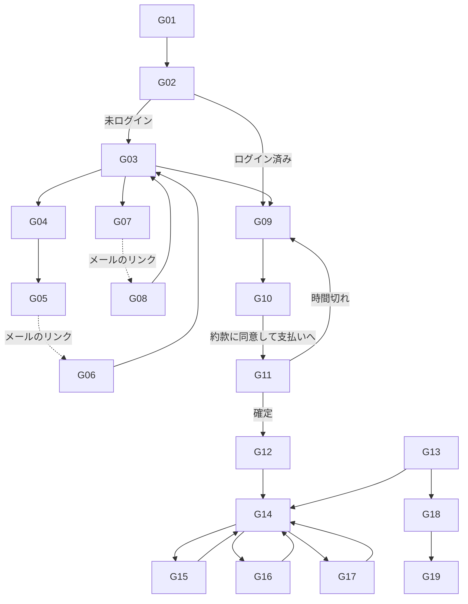
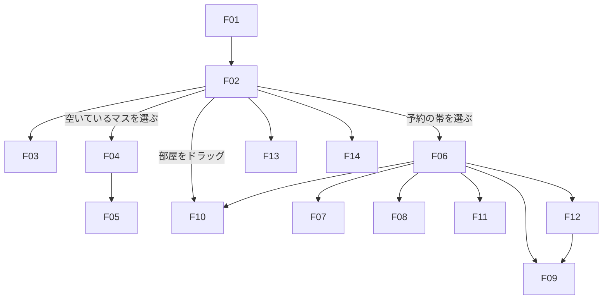
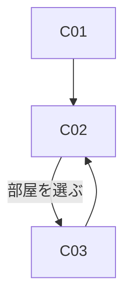

# 画面設計：hotel-reservation-system

[design.md](design.md) の補足資料（テスト設計で決めた細部は design.md の「設計の補足」が優先する）。画面一覧、画面遷移、各画面の機能・入力項目・表示項目・エラー表示を定める。API とエラーコードは design.md を参照する。要件の参照は `4.10` の形で書く。

## 共通の約束

| 項目 | 内容 |
|---|---|
| 画面 ID | G＝宿泊客アプリ（外部公開）、F＝フロントアプリ（社内）、C＝清掃アプリ（社内）、A＝管理者メニュー（後のフェーズ。フロントアプリに追加） |
| 言語 | 宿泊客アプリは全画面の右上で5言語（日本語・English・한국어・简体中文・繁體中文）を切り替える。ログイン中は会員の言語として保存する（16.1, 15.1）。スタッフ向けは日本語のみ（16.6） |
| 時刻 | どの言語でも日本時間で表示し、時刻の横に「日本時間」の表記をつける（16.3） |
| 金額 | 税込みの総額で表示する。宿泊税は別の行に分けて表示する（6.17, 3.7） |
| 入力の誤り | 項目の下に赤字で理由を表示し、最初の誤りの項目に移動する |
| 業務エラー | 画面上部の帯で表示する（design.md の Error Handling の表のとおり） |
| ログイン切れ | ログイン画面に移り、ログイン後に元の画面に戻る |
| 端末 | 宿泊客アプリはスマホを主とし PC でも使える。フロントアプリは PC。清掃アプリはタブレット・スマホ |

## 画面一覧

### 宿泊客アプリ（guest-web、外部公開）

| ID | 画面 | ログイン | 主な要件 |
|---|---|---|---|
| G01 | 空室検索（トップ） | 不要 | 3.1, 3.5, 3.6 |
| G02 | 検索結果 | 不要 | 3.2〜3.4, 3.7 |
| G03 | ログイン | 不要 | 4.1 |
| G04 | 会員登録 | 不要 | 1.1〜1.3, 1.5 |
| G05 | 登録の受付（確認メールを送信） | 不要 | 1.4 |
| G06 | メールアドレスの確認 | 不要 | 1.4 |
| G07 | パスワード再設定の申込 | 不要 | 1.9 |
| G08 | パスワードの再設定 | 不要 | 1.9 |
| G09 | 予約入力 | 必要 | 4.2〜4.13, 14.7 |
| G10 | 予約内容の確認・約款への同意 | 必要 | 4.14, 4.15, 6.x |
| G11 | 支払い（確保中） | 必要 | 4.16〜4.21 |
| G12 | 予約完了 | 必要 | 4.22, 4.23 |
| G13 | マイページ（予約一覧） | 必要 | 7.1 |
| G14 | 予約詳細 | 必要 | 7.1, 14.3 |
| G15 | 予約変更 | 必要 | 7.2〜7.16, 7.22 |
| G16 | キャンセル | 必要 | 8.1〜8.13 |
| G17 | 名簿情報の入力 | 必要 | 4.8, 4.9, 14.1〜14.3 |
| G18 | 会員情報 | 必要 | 1.6〜1.8 |
| G19 | 退会 | 必要 | 1.11 |
| G20 | 配信停止 | 不要（メールのリンクから） | 1.7, 15.7 |
| G21 | エラー（ページがない・時間切れなど） | — | — |

### フロントアプリ（front-web、社内）

| ID | 画面 | 役割 | 主な要件 |
|---|---|---|---|
| F01 | スタッフログイン | — | 2.1 |
| F02 | 予約状況チャート | フロント以上 | 10.1〜10.7, 10.13, 9.16, 11.6, 13.3 |
| F03 | お知らせ（ダイアログ） | フロント以上 | 10.14, 10.15 |
| F04 | 予約登録 | フロント以上 | 5.1〜5.5 |
| F05 | 会員検索（ダイアログ） | フロント以上 | 5.1, 5.2 |
| F06 | 予約詳細（フロント） | フロント以上 | 5.6, 7.3, 8.1, 8.13, 8.15, 8.17, 8.28〜8.30 |
| F07 | 予約変更（フロント） | フロント以上 | 7.3〜7.15 |
| F08 | 名簿の入力（フロント） | フロント以上 | 14.4 |
| F09 | 精算 | フロント以上 | 11.4〜11.6, 11.9 |
| F10 | 部屋の移動・入れ替え（ダイアログ） | フロント以上 | 9.6〜9.15 |
| F11 | チェックイン（ダイアログ） | フロント以上 | 11.1〜11.3, 11.10 |
| F12 | チェックアウト（ダイアログ） | フロント以上 | 11.7, 11.8, 11.14, 13.6 |
| F13 | 故障中の設定 | フロント以上 | 13.1〜13.8 |
| F14 | 特定期間割増 | フロント以上 | 17.1, 17.2 |

### 清掃アプリ（cleaning-web、社内）

| ID | 画面 | 役割 | 主な要件 |
|---|---|---|---|
| C01 | スタッフログイン | — | 2.1 |
| C02 | 清掃状況一覧 | 清掃員以上 | 2.3, 12.1, 12.8 |
| C03 | 状態の変更（ダイアログ） | 清掃員以上 | 12.2〜12.4, 12.7 |

### 管理者メニュー（後のフェーズ。フロントアプリに追加）

| ID | 画面 | 主な要件 |
|---|---|---|
| A01 | 料金の設定（料金の版の作成） | 21.1, 21.7 |
| A02 | 客室タイプ・部屋の設定 | 21.2 |
| A03 | 名簿の項目の設定 | 21.3 |
| A04 | スタッフのアカウント | 21.4 |
| A05 | 翻訳文の編集 | 21.5, 21.6 |
| A06 | 返金・キャンセル料の免除・料金の手動変更 | 22.1 |
| A07 | 操作履歴 | 22.2 |
| A08 | 売上・稼働率の集計 | 20.1〜20.6 |

## 画面遷移

### 宿泊客アプリ

- どの画面からも、ヘッダーのメニューで G01・G13・G18・ログアウトに移れる
- G03 は「ログイン後に戻る画面」を持つ（G02 から来た場合は G09 に、選んだ検索条件のまま進む）

### フロントアプリ

### 清掃アプリ

## 各画面の詳細

### G01 空室検索（トップ）

**機能**：宿泊の条件を入力して空室を探す。ログインは不要（3.1）

| 入力項目 | 必須 | 形式・検証 |
|---|---|---|
| 到着日 | ○ | 日付。今日（0:00〜0:59 は前日）以降、今日から365日以内 |
| 泊数 | ○ | 1以上の整数。到着日＋泊数−1 の夜が365日以内（3.5） |
| 大人 | ○ | 1以上の整数 |
| 子ども（3歳〜小学生） | ○ | 0以上の整数（上限なし。4.6） |
| 幼児（2歳以下） | ○ | 0以上の整数 |
| 室数 | ○ | 1以上、大人の人数以下（4.5） |

**表示項目**：言語の切り替え、ログイン・会員登録への入口、チェックイン15:00〜25:00・チェックアウト12:00 の案内
**エラー**：OUT_OF_BOOKING_WINDOW（「365日より先の宿泊は予約できません」）、SAME_DAY_CUTOFF_PASSED（「本日の受付は終了しました（最終チェックイン 25:00）」）

### G02 検索結果

**機能**：条件に合う客室タイプを、空室の有無と料金とともに表示する

| 表示項目 | 内容 |
|---|---|
| 客室タイプ | 名前・広さ・寝具・定員・説明（日本語以外は翻訳文。16.4）・写真 |
| 空室 | 「空室あり」「満室」。全日程を通して同じ部屋が空いていれば空室あり（3.2） |
| 料金 | 合計（税込み）と、夜ごとの1人あたりの単価（大人・子ども）、宿泊税（別行）。早期割の対象なら「事前決済で早期割10%」の表示と、その場合の料金（3.7, 6.12） |
| 定員の条件 | 1室なら定員が大人の人数以上のタイプだけを表示（3.3）。2室以上なら「大人の人数 ≦ 室数 × 定員」のタイプだけ |

**操作**：「このタイプで予約する」→ ログイン済みなら G09、未ログインなら G03（4.1）

### G03 ログイン
| 入力項目 | 必須 | 形式・検証 |
|---|---|---|
| メールアドレス | ○ | メールの形式 |
| パスワード | ○ | — |

**操作**：ログイン、会員登録へ（G04）、パスワードを忘れた方へ（G07）
**エラー**：INVALID_CREDENTIALS（「メールアドレスまたはパスワードが違います」）、EMAIL_NOT_VERIFIED（確認メールの再送ボタンを表示）、RATE_LIMITED

### G04 会員登録
| 入力項目 | 必須 | 形式・検証 |
|---|---|---|
| 氏名（姓・名） | ○ | 1〜50文字 |
| 住所（国・郵便番号・住所） | ○ | 国は一覧から選ぶ。日本の場合は郵便番号7桁 |
| 日本に住所がない外国人か | ○ | はい・いいえ。「はい」なら国籍・旅券番号が必須（1.2） |
| 国籍・旅券番号 | 条件 | 国籍は一覧から。旅券番号は英数字6〜12文字 |
| 電話番号 | ○ | 数字10〜15桁（国番号を含めてよい）。有効な会員と重複不可（1.3） |
| メールアドレス | ○ | メールの形式。有効な会員と重複不可（1.3） |
| 生年月日 | ○ | 日付。今日より前 |
| パスワード | ○ | 10文字以上、英字と数字を含む。確認用と一致 |
| クレジットカード（番号・有効期限・名義） | ○ | 番号13〜19桁、有効期限は今月以降（1.1） |
| 利用する言語 | ○ | 5言語から。初期値は画面の言語 |
| 定期配信メールの受信 | — | チェックボックス。初期状態は「受け取らない」（1.5） |

**操作**：登録 → G05
**エラー**：EMAIL_ALREADY_REGISTERED、PHONE_ALREADY_REGISTERED（「すでに登録されています。ログインまたはパスワードの再設定をご利用ください」）、PAYMENT_DECLINED（「このカードは登録できません」）

### G05 登録の受付・G06 メールアドレスの確認
- G05：「確認メールを送りました。24時間以内にリンクを開いてください」と表示する（1.4）
- G06：メールのリンクから開き、確認できたら「登録が完了しました」とログインへの案内を表示する。期限切れ・使用済みなら、再登録の案内を表示する

### G07 パスワード再設定の申込・G08 パスワードの再設定
- G07：メールアドレスを入力すると、登録の有無にかかわらず「メールを送りました」と表示する（登録の有無を推測させない。1.9）
- G08：新しいパスワード（G04 と同じ条件）を2回入力する。期限（1時間）切れなら G07 への案内

### G09 予約入力

**機能**：選んだ客室タイプで予約の内容を入力する。会員情報は自動で入力される（4.7）

| 入力項目 | 必須 | 形式・検証 |
|---|---|---|
| 到着日・泊数・室数・人数 | ○ | G01 の値を引き継ぎ、ここでも変更できる。客室タイプは1つだけ（4.2） |
| 予約者が宿泊するか | ○ | はい・いいえ。「いいえ」なら宿泊者（代表者）の氏名・住所・連絡先を入力（4.8） |
| 同行者の情報 | 条件 | 「今入力する」なら人数分（宿泊人数 − 1、予約者が泊まらない場合は宿泊人数 − 代表者1名）の氏名・住所・年齢区分。連絡先は予約者の連絡先を自動で入れる（後から G17 で変えられる。14.7、DT-M36）。「現地で入力」も選べる（4.9） |
| 到着予定時刻 | — | 15:00〜25:00 を30分単位（アーリーを選んだ部屋がある場合はその時刻から） |
| 朝食の人数 | ○ | 大人・子ども・幼児ごとに、朝食をつける人数（0〜各区分の人数）。全泊に同じ人数を適用。初期値は0（4.10） |
| アーリーチェックイン | — | なし・12:00・13:00・14:00。最初は全室同じで、「部屋ごとに設定」を開くと部屋ごとに変えられる（4.10） |
| レイトチェックアウト | — | なし・13:00・14:00・15:00。アーリーと同じく部屋ごとに変えられる（4.10） |
| 支払い方法 | ○ | 事前決済・現地払い。早期割の対象のときは「事前決済（早期割10%）」と「現地払い（早期割なし）」の違いを表示する（4.11, 4.12） |

**表示項目**：会員情報（氏名・住所・連絡先。4.7）、料金の見積もり（入力を変えるたびに更新）、現地払いの場合は「登録済みのカード（末尾 1234）をカード保証に使います」（4.13）
**エラー**：CAPACITY_EXCEEDED（「大人の人数が部屋の定員を超えています」。4.4）、ROOMS_EXCEED_ADULTS（「室数は大人の人数以下にしてください」。4.5）、MIXED_ROOM_TYPES_NOT_ALLOWED、EARLY_BIRD_REQUIRES_PREPAID、予約者の年齢区分と人数の不一致（6.3）

### G10 予約内容の確認・約款への同意

**機能**：料金の内訳を確認し、宿泊約款に同意する（4.14, 4.15）

| 表示項目 | 内容 |
|---|---|
| 予約内容 | 客室タイプ・室数・日程・人数・朝食・時間外・支払い方法 |
| 料金の内訳 | 夜ごと×年齢区分の単価と人数、朝食、合計（税込み）。宿泊税は別行。時間外の料金は「現地でお支払い」と表示（6.13〜6.16） |
| キャンセル規定 | この予約に適用される規定（個人／団体／早期割は返金不可）と、無料で取り消せる期限の日時 |
| 宿泊約款 | 全文（日本語以外は翻訳文。16.4） |

| 入力項目 | 必須 | 形式・検証 |
|---|---|---|
| 宿泊約款に同意する | ○ | チェックがないと「支払いへ進む」を押せない（4.15） |

**操作**：「支払いへ進む」→ 部屋の確保（15分）→ G11（4.16）
**エラー**：NO_AVAILABILITY（「直前に満室になりました」→ G02 で再検索）、HOLD_ALREADY_EXISTS（「お支払い待ちの予約があります」→ その予約の G11 へ。4.18）

### G11 支払い（確保中）

**機能**：確保した部屋の期限内に、予約を確定する

| 表示項目 | 内容 |
|---|---|
| 残り時間 | 15分からのカウントダウン（4.16） |
| 支払い内容 | 事前決済：決済額（時間外の料金を除く全額。4.19）と登録カード（末尾4桁）。現地払い：カード保証に使う登録カード |

**操作**：「予約を確定する」→ G12。カードの変更（G18 へ移らずに、その場でカードを差し替えるダイアログ）
**エラー**：PAYMENT_DECLINED（「カードが利用できませんでした。別のカードに変更してください」。4.21）、PAYMENT_GATEWAY_UNAVAILABLE、HOLD_EXPIRED（「時間切れのため部屋の確保を解除しました」→ G09。4.17）
**エラー（続き）**：ALREADY_CONFIRMED（「この予約はすでに確定しています」→ G14。別のタブなどで確定した場合。L-25）、PRICE_CHANGED（「お支払いの手続き中に料金が変わりました。新しい料金をご確認ください」→ 新しい料金を表示し、もう一度確定を押させる。4.24）、SAME_DAY_CUTOFF_PASSED（「本日の受付は終了しました」。4.25）

### G12 予約完了
**表示項目**：予約番号（4.22）、予約内容の要約、「確認メールを送りました」（事前決済の場合は「予約完了」と「入金完了」の2通。4.23）、名簿を「現地で入力」にした場合は G17 への案内

### G13 マイページ（予約一覧）
**表示項目**：予約ごとに予約番号・日程・客室タイプ・室数・状態（お支払い待ち〔残り○分〕・確定・滞在中・完了・キャンセル・ノーショー）・支払い状況（7.1）。お支払い待ちの予約からは G11 に戻れる。期限切れの予約は表示しない（7.20、DT-M9）。今後の予約と過去の予約に分ける
**操作**：予約を選ぶ → G14、会員情報 → G18

### G14 予約詳細
| 表示項目 | 内容 |
|---|---|
| 予約内容 | G10 と同じ項目、予約番号、状態 |
| 料金と支払い | 明細（有効なもの）、支払い済みの額、返金額、現地で支払う額（7.1） |
| 名簿 | 入力済みの人数 / 宿泊人数（14.3） |

**操作**：変更（G15）、キャンセル（G16）、名簿の入力（G17）。部屋の変更・アップグレードの申込の手段は設けない（9.15）。お支払い待ち・滞在中・完了・キャンセル・ノーショーの予約には、変更とキャンセルのボタンを出さない（7.22、L-2。滞在中の延長・早期チェックアウトはフロントで行う）

### G15 予約変更
| 入力項目 | 必須 | 形式・検証 |
|---|---|---|
| 到着日・泊数・室数・人数・朝食・時間外 | — | G09 と同じ条件（7.2, 7.11） |

| 表示項目 | 内容 |
|---|---|
| 変更前と変更後の料金 | 明細の比較。追加分は変更時点の料金表、もとの部分は予約時の料金であることを表示（7.4） |
| 差額 | 事前決済：今カードに請求する額・返金する額。現地払い：現地で支払う額の増減（7.12〜7.15） |
| キャンセル料 | 減らす変更がある場合（7.6）。早期割の予約は「減らした分は返金されません」（7.7） |

**操作**：「変更を確定する」→ G14、変更完了のメール（7.16）
**エラー**：EXTENSION_ROOM_UNAVAILABLE（「延ばした日は同じお部屋に空きがありません。ホテルにお問い合わせください」。7.10）、NO_AVAILABILITY（「ご希望の日程・室数のお部屋に空きがありません」。L-26）、NOT_MODIFIABLE（「この予約は変更できません」。7.22）、CAPACITY_EXCEEDED、PAYMENT_DECLINED（「差額の決済ができなかったため、変更していません」。7.13）、QUOTE_OUTDATED（見積もりを表示し直す）

### G16 キャンセル
| 入力項目 | 必須 | 形式・検証 |
|---|---|---|
| キャンセルの範囲 | ○ | 予約全体（部分的な取消は G15 で行う） |

**表示項目**：キャンセル料・返金額・現地払いの場合のカードへの請求額を、確定する前に表示する（8.2）。返金しない宿泊税は、キャンセル料とは別の行で示す（DT-M7）。適用した規定は「無料期間内」「期限後（1泊分）」「団体（20%）」「団体（50%）」「団体（100%）」「早期割（返金不可）」のいずれかで示す（L-32）
**エラー**：NOT_CANCELLABLE（「この予約はキャンセルできません」）、QUOTE_OUTDATED（時刻が過ぎてキャンセル料が変わった場合も、最新の額を表示し直す。L-31）
**操作**：「キャンセルを確定する」→ G14、キャンセル完了のメール（8.13）

### G17 名簿情報の入力
| 入力項目 | 必須 | 形式・検証 |
|---|---|---|
| 宿泊者ごとの氏名 | ○ | 宿泊人数分の行（子ども・幼児を含む。14.2） |
| 住所 | ○ | 予約者と同じ住所をコピーできる |
| 連絡先 | ○ | 子ども・幼児は予約者の連絡先を引き継げる |
| 年齢区分 | ○ | 大人・子ども・幼児。各区分の行数が予約の人数と一致 |
| 日本に住所がない外国人か・国籍・旅券番号 | 条件 | 「はい」なら国籍・旅券番号が必須（14.1） |
| 追加項目 | 条件 | roster_fields で必須のもの（14.5） |

**操作**：保存（途中保存も可）。すべてそろうと「名簿の入力が完了しました」と表示する（14.3）

### G18 会員情報
**機能**：会員情報の確認と変更、カードの差し替え、配信の同意の変更（1.6〜1.8）
| 入力項目 | 必須 | 形式・検証 |
|---|---|---|
| G04 と同じ会員情報 | ○ | G04 と同じ（パスワードの変更は現在のパスワードが必要）。メールアドレスを変えると、新しいアドレスに確認メールを送り、確認が終わるまで反映しない（1.12、DT-M4） |
| カード | ○ | 「カードを変更」だけ。削除のボタンは設けない（1.8） |
| 定期配信メールの受信 | — | 変更すると、日時と方法（会員情報の画面）を記録（1.6, 1.7） |

### G19 退会
**表示項目**：退会すると削除される情報（カード・パスワード・配信の同意）と、名簿は法令のため最終宿泊日から3年保存されること
**入力項目**：パスワード（必須）
**エラー**：HAS_ACTIVE_RESERVATION（「今後の予約があるため退会できません。先にキャンセルしてください」）、HAS_UNPAID_BALANCE（未回収の額と振込先を表示し、支払いを案内する。1.13、DT-M19）

### G20 配信停止
**機能**：定期配信メールのリンクから開き、ログインせずに受信の同意を取り消す（1.7, 15.7）。取り消しの日時と方法（配信停止のリンク）を記録する

### F01・C01 スタッフログイン
| 入力項目 | 必須 | 形式・検証 |
|---|---|---|
| スタッフ番号 | ○ | — |
| パスワード | ○ | — |

**動作**：役割を判別し（2.1）、フロントアプリは F02、清掃アプリは C02 へ移る。清掃員がフロントアプリにログインした場合は「この画面を使う権限がありません」と表示する（2.2, 2.4）

### F02 予約状況チャート

**機能**：部屋×日付の予約状況を表示し、そこから登録・詳細・移動を行う（10.1〜10.7）

| 表示項目 | 内容 |
|---|---|
| ヘッダー | 表示の開始日、期間の切り替え（1週間・2週間・1か月。10.6）、予約番号の検索（10.5）、お知らせのベル（解決していない件数を赤丸のバッジで表示。10.13） |
| チャート | 横軸は日付（1日1列）、縦軸は部屋番号（客室タイプごとにまとめ、タイプ名の見出しをつける。10.1）。予約は宿泊する夜の範囲の帯で、チェックアウト日の列は塗らない（10.2）。帯には予約番号・代表者名・人数・支払い方法・時間外の印を表示 |
| マスの見分け | 予約のないマスは白、予約は色つきの帯、決済待ちは斜線、故障中の期間は灰色で「故障中」と表示（10.3, 10.4） |
| 対応が必要な一覧（横の欄） | 故障中の部屋に割り当てられた予約（9.16）、終了予定日を過ぎた故障中（13.3）、要精算（7泊を超える現地払い。11.6）、**未回収**（キャンセル料・ノーショー料のカードへの請求が断られた予約と、その額。現地払いの変更によるキャンセル料を含む。8.22, 8.23）、**返金待ち**（ノーショーの返金が決済サービスの障害で失敗し、再試行中の予約と額。8.26）、決済の照合待ち（決済の後の処理が失敗し、取り消しが終わっていない決済。L-29）、送信できなかったメール。状態が解消すると自動で消える |

**操作**：空いているマスを選ぶ → F04（その部屋のタイプと日付を入れた状態）。帯を選ぶ → F06。帯を別の部屋の行にドラッグ → F10。予約番号を検索すると、その帯が表示されるようにスクロールして強調する（10.5）。ベル → F03

### F03 お知らせ（ダイアログ）
| 表示項目 | 内容 |
|---|---|
| 一覧 | 解決していないお知らせ（新しい順）。種類（連泊できない在庫なし・離れた部屋・清掃時間の不足）、対象（客室タイプと日程／予約番号／部屋と日付）、作成日時 |
| メッセージ | 選んだお知らせの本文（10.14）。例：「スタンダード キング 11/3〜11/5：各夜に空室はありますが、連泊できる部屋がありません」「601号室 11/3：前の客のレイトチェックアウト 14:00 から次の客のチェックイン 15:00 まで1時間しかありません」 |

**操作**：「解決」→ 解決済みにし、バッジの件数を減らす（10.15）。対象の予約・部屋へ移るリンク

### F04 予約登録
**機能**：電話・来館の会員の予約を登録する（5.1〜5.5）

| 入力項目 | 必須 | 形式・検証 |
|---|---|---|
| 予約者（会員） | ○ | F05 で会員を検索して選ぶ。会員でない人は登録できない（5.2） |
| G09 と同じ予約の内容 | ○ | G09 と同じ条件（5.4）。約款への同意の欄はない |
| 支払い方法 | ○ | 事前決済（会員の登録カードで決済。5.5）・現地払い |

**表示項目**：会員の氏名・連絡先・登録カードの末尾4桁、料金の見積もり
**操作**：「登録する」→ その場で確保と確定を行い F06 へ
**補足**：来館した非会員には、本人のスマホ（またはロビーの端末）で宿泊客アプリの会員登録（G04）をしてもらい、その後に F05 で検索する（5.3、ADR-11）

### F05 会員検索（ダイアログ）
**入力項目**：氏名・電話番号・メールアドレスのいずれか（部分一致）
**表示項目**：一致した会員の氏名・電話番号・メールアドレス・生年月日（有効な会員だけ）

### F06 予約詳細（フロント）
| 表示項目 | 内容 |
|---|---|
| 予約内容 | G14 の項目に加え、割り当てた部屋（部屋ごとの時間外・アップグレードの種類）、団体かどうか、到着予定時刻、操作の履歴 |
| 残高 | 現地で精算する額、事前決済の支払い済みの額 |
| 名簿 | 入力済み / 宿泊人数 |

**操作**
- 変更 → F07、キャンセル（G16 と同じ確認のダイアログ。8.1, 8.2）
- 名簿 → F08、精算 → F09、チェックイン → F11、チェックアウト → F12
- 部屋ごとの時間外（アーリー・レイト）の追加・変更・「なし」への変更（5.6。到着日より前でも当日でもできる：DT-M47。送るのはその部屋の時間外の全体：L-46）
- 部屋の移動・入れ替え → F10
- ノーショーの判定を延ばす（判定の前の予約だけ表示。期限の時刻は到着日の25:00より後、最も遅くて翌日12:00。8.15, 8.28）
- ノーショーの取り消し（NO_SHOW の予約だけ、出発日のチェックアウト時刻より前まで表示。8.17, 8.29）。もとの部屋が故障中の期間に入っている夜も戻し、警告の一覧に出る（8.30）

**エラー**：RESERVATION_STATUS_INVALID（延長・取り消しができない状態・時刻）、VALIDATION_FAILED（延長の期限が範囲外）

### F07 予約変更（フロント）
G15 と同じ項目・表示・エラー（7.3）。早期チェックアウト（出発日を早める）もこの画面で行う（8.10）

### F08 名簿の入力（フロント）
G17 と同じ項目（14.4）。紙やメールで受け取った情報を入力する

### F09 精算
| 表示項目 | 内容 |
|---|---|
| 未精算の明細 | 現地で精算する明細（宿泊料金〔現地払い〕、時間外、有償アップグレード、キャンセル料の調整など）と残高（11.4, 11.5） |
| 要精算の区切り | 7泊を超える現地払いは、今回精算する範囲（1〜7泊目など）を表示（11.6） |

| 入力項目 | 必須 | 形式・検証 |
|---|---|---|
| 種類 | ○ | 入金・払い戻し。払い戻しは残高がマイナス（払い過ぎ）のときだけ選べる（11.12） |
| 金額 | ○ | 1円以上。入金は残高以下、払い戻しは払い過ぎの額以下 |
| 方法 | ○ | 現金・カード・振込・その他（振込は、未回収の支払いを振込で受け取ったときに使う。8.24） |

**操作**：「入金を記録する」→ 入金完了のメール（11.9）
**エラー**：AMOUNT_EXCEEDS_BALANCE

### F10 部屋の移動・入れ替え（ダイアログ）
| 入力項目 | 必須 | 形式・検証 |
|---|---|---|
| 移し先の部屋 | ○ | 別の客室タイプの部屋も選べる（9.6）。入れ替えの場合は相手の予約の部屋 |
| 無償・有償 | 条件 | 上位のタイプへ移すときに必須（9.11） |
| その部屋の人数 | 条件 | 2室以上の予約で一部の部屋のタイプを変えるときに必須（ADR-12） |

**表示項目**：移し先のタイプ・定員、差額（有償の場合の追加額、下位タイプの場合の返金額）
**動作**
- 移し先の定員が大人の人数より少なければ、ダイアログ「移し先の部屋の定員が大人の人数より少ないですがよろしいですか？」（はい／いいえ）を表示し、「はい」のときだけ移す（9.9）
- 移した結果、離れた部屋や清掃時間の不足が生じたら、お知らせができる（10.10, 10.11）

**エラー**：ROOM_OCCUPIED、ROOM_OUT_OF_ORDER（9.8）、CHECKED_IN_ROOM_CHANGE_NOT_ALLOWED（「チェックイン後は、故障のときだけ部屋を移せます」。9.14）

### F11 チェックイン（ダイアログ）
**表示項目**：名簿の状態（不足している人数・項目）、割り当てた各部屋の状態、渡す朝食券の枚数（朝食の日付ごと・大人・子ども・幼児ごと。11.10）
**動作**：名簿がそろい、すべての部屋が「清掃完了」なら、チェックインし部屋を「チェックイン済み」にする（11.1〜11.3）。ノーショーの予約では、先にノーショーの取り消しを行う（8.17）
**エラー**：ROSTER_INCOMPLETE（「名簿があと2名分足りません」→ F08 への案内）、ROOM_NOT_CLEAN（「601号室は清掃中です」→ F10 での部屋の移動を案内）

### F12 チェックアウト（ダイアログ）
**表示項目**：残高、出発日（予定より早い場合は「早期チェックアウトとして残りの夜を取り消します」とキャンセル料）
**動作**：予定より早い場合は、キャンセル料を確認させてから早期チェックアウト（F07 と同じ変更）を行い、その後にチェックアウトする（早期チェックアウトをせずにチェックアウトの API を呼ぶと EARLY_CHECKOUT_REQUIRED。11.14）。残高が0なら、チェックアウトして部屋を「清掃可」にする（11.7, 11.8。今日から故障中の期間に入る部屋は「故障中」にする。13.6）。残高が正（未精算）なら F09 で入金を、残高が負（払い過ぎ）なら F09 で払い戻しを記録してから行う（11.11）
**エラー**：UNSETTLED_BALANCE、EARLY_CHECKOUT_REQUIRED、RESERVATION_STATUS_INVALID

### F13 故障中の設定
| 入力項目 | 必須 | 形式・検証 |
|---|---|---|
| 部屋 | ○ | 部屋番号 |
| 開始日 | ○ | 日付。営業日の今日以降（13.8） |
| 終了予定日 | ○ | 開始日以降（13.1） |
| 理由 | — | 200文字以内 |

**表示項目**：故障中の部屋の一覧（終了予定日を過ぎたものは強調。13.3）、その期間に割り当てられている予約
**動作**：開始日に今日チェックアウトする客がまだいる部屋は、チェックアウトの操作のときに「故障中」になる（13.6）。今夜も泊まる客がいる部屋はすぐ「故障中」になり、警告の一覧で移動を促す（13.7）
**エラー**：OVERLAPPING_PERIOD（「この部屋のほかの故障中の期間と重なっています」。終了予定日の延長でも同じ：DT-M39）、VALIDATION_FAILED（開始日が過去、終了予定日が開始日より前。13.8）
**操作**：設定、終了予定日の延長、修理の完了（「清掃完了」に戻す。終了予定日より前でも当日でも、その日の夜から在庫に戻る。13.4, 13.5、DT-M46）

### F14 特定期間割増
| 入力項目 | 必須 | 形式・検証 |
|---|---|---|
| 開始日・終了日 | ○ | 開始日 ≦ 終了日。ほかの特定期間と重ならない |
| 割増率 | ○ | 1〜100%（整数） |

**表示項目**：登録済みの期間の一覧（17.1）、「変更はこれから確定する予約と追加分にだけ反映されます」の注記（17.2）
**操作**：登録・変更・削除

### C02 清掃状況一覧

**機能**：部屋ごとの状態を一覧し、状態を変える（12.1, 12.8）

| 表示項目 | 内容 |
|---|---|
| 部屋 | 階ごとにまとめ、部屋番号・状態（色分け）を表示 |
| 予定 | 今日のチェックアウト予定（レイトの場合は「レイト 14:00」）、今日のチェックイン予定（アーリーの場合は「アーリー 13:00」）（2.3, 12.8） |
| 絞り込み | 階、状態（例：清掃可だけ、清掃有（連泊）だけ） |

- 宿泊者の氏名などの個人情報は表示しない（2.3）
- 1分ごとに自動で最新の状態に更新する

### C03 状態の変更（ダイアログ）
**表示項目**：現在の状態と、ログインしている役割で変えられる状態だけのボタン
- 清掃員：空室の清掃グループの中、連泊グループの中の状態（12.2）と、「来客なし」→「清掃完了」（12.7）。「その他」のグループの中の変更（例：故障中→チェックイン済み）のボタンは出さない。清掃を断られた連泊の部屋は、清掃しないで「清掃完了（連泊）」にできる
- フロント以上：すべての状態（12.4）

**エラー**：STATUS_TRANSITION_NOT_ALLOWED（12.3）

### A01〜A08（後のフェーズ）
要件 20〜22 のとおり。MVP では作らない。使うテーブル（rate_versions、room_type_prices、roster_fields、staff、translations、charge_lines、payments、audit_logs）は MVP で作る。
