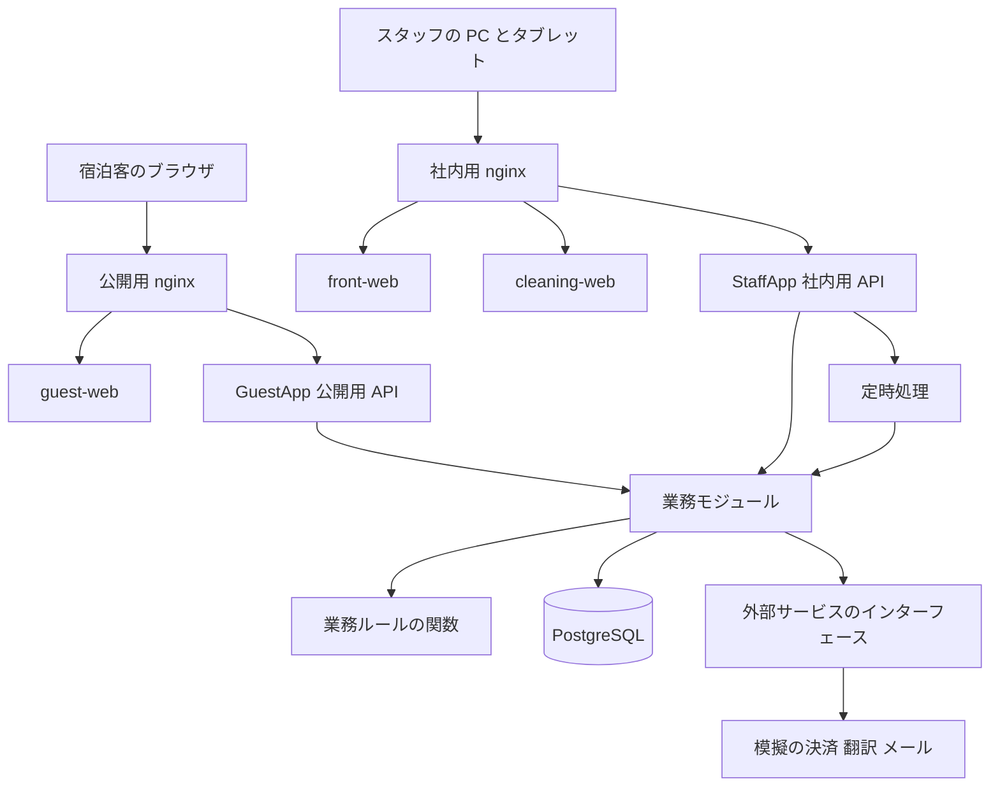
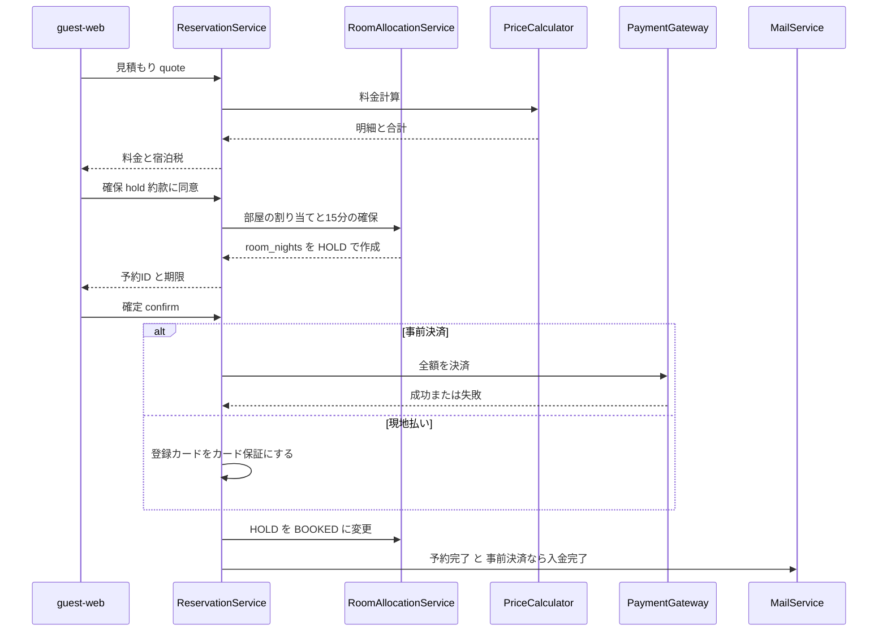
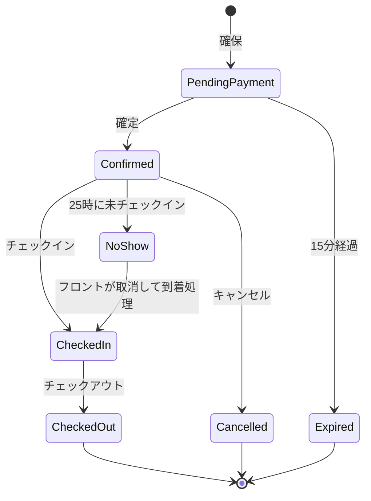
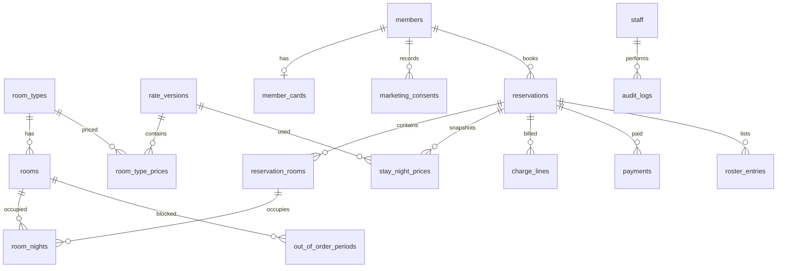

# 設計書：hotel-reservation-system

## 文書の構成

| 文書 | 内容 |
|---|---|
| design.md（本書） | 全体構成、境界、技術スタック、ファイル構成、処理の流れ、コンポーネントと API、データ設計、処理仕様と業務ルール、エラー時の動作、テスト方針 |
| [design-screens.md](design-screens.md) | 画面一覧、画面遷移、各画面の機能・入力項目・表示項目・エラー表示 |
| [traceability.md](traceability.md) | 要件の受け入れ基準（238件）ごとの、画面・API・処理・テーブル・テストとの対応表 |
| [research.md](research.md) | 調査の記録と、設計判断の記録（ADR-01〜15） |

用語は [context.md](context.md) の定義に従う。要件の参照は `6.13`（要件6の受け入れ基準13）の形で書く。

## Overview

**Purpose**：架空のホテル（253室・7客室タイプ）の予約業務を、会員制の Web 予約とスタッフ向けの業務画面で処理し、電話対応と手作業を減らす。

**Users**：宿泊客（会員）は宿泊客アプリで検索・予約・変更・キャンセルを行う。フロントはフロントアプリで予約状況チャート・割り当て・チェックイン／チェックアウト・精算を行う。清掃員は清掃アプリで部屋の状態を更新する。管理者メニューは後のフェーズで、フロントアプリに追加する。

**Impact**：新規開発である。既存のシステムやデータの移行はない。

### Goals
- 要件 1〜19 の受け入れ基準をすべて満たす MVP を作る（要件 20〜22 は後のフェーズ。データ構造だけを先に用意する）
- 二重割り当てが、同時に予約されても起きない
- 料金・キャンセル料・宿泊税の計算が、要件の計算例と境界値のテストで再現できる

### Non-Goals
- OTA 連携、複数施設、外貨、付帯施設、駐車場、与信の確認（要件の Out of scope）
- 本物の決済・機械翻訳・メール送信サービスとの接続（模擬実装で代える。ADR-05）
- 外部公開の運用作業（TLS 証明書の取得、ファイアウォールの設定）

## Boundary Commitments

### This Spec Owns
- 予約の作成・変更・キャンセル・ノーショー・チェックイン・チェックアウトの業務処理と、その状態
- 在庫（部屋×宿泊日の占有）と部屋の割り当て
- 料金・キャンセル料・宿泊税の計算と、請求の明細・入金・返金の記録
- 部屋の状態（清掃状況・故障中）と、その移り方
- 会員・スタッフの認証とセッション、権限の判定
- 宿泊者名簿、お知らせ・警告、操作履歴、メールの作成、宿泊客向けの翻訳文の保存
- 個人情報の削除（定時処理）
- 3つの画面アプリと、API の契約（packages/contracts）

### Out of Boundary
- 決済・機械翻訳・メール送信の実際の処理（インターフェースの先にある外部サービス。MVP では模擬実装）
- 宿泊約款の文章そのもの（保存と表示は本仕様の範囲）
- 管理者メニューの画面（要件 20〜22）の実装。ただし、それが使うテーブル（料金の版、操作履歴、明細）は本仕様で作る
- サーバーの調達、TLS 証明書、外部公開のネットワーク設定

### Allowed Dependencies
- PostgreSQL 17 以上（唯一のデータの保存先）
- 決済・翻訳・メールは、それぞれ PaymentGateway・Translator・MailSender のインターフェースだけを通して使う。業務のコードから模擬実装を直接呼ばない
- 画面アプリは API（HTTP）だけに依存する。画面アプリどうしは依存しない。画面アプリと API の間で共有するのは packages/contracts（型と入力の検証）だけ
- 祝日の判定は holidays テーブルだけを使う

### Revalidation Triggers
- packages/contracts の型・エラーコードの変更（3つの画面アプリすべてに影響）
- room_nights・charge_lines・stay_night_prices の構造の変更（在庫・料金・後の集計に影響）
- 料金の版（rate_versions）の項目の変更（管理者メニューと料金計算に影響）
- 公開用と社内用の API の振り分けの変更（外部公開の範囲に影響）
- 定時処理の時刻の変更（9:00、1:00、前日10:00 など。要件の基準値に直結する）

## Architecture

### Architecture Pattern & Boundary Map



**Architecture Integration**
- **方式**：1つの NestJS のコードベースを業務ごとのモジュールに分ける。業務ルール（料金・キャンセル料・割り当て・状態の移り方・団体の判定）は、フレームワークとデータベースに依存しない純粋な関数として domain/ に置く（research.md の Architecture Pattern Evaluation）
- **公開範囲の分離**：1つのプロセスで2つの待ち受け口を立てる。公開用の GuestApp（ポート3001）は宿泊客向けのコントローラーだけを持ち、社内用の StaffApp（ポート3002）はスタッフ向けのコントローラーと定時処理を持つ（ADR-03）
- **依存の向き（違反はレビューで不合格とする）**：

  `packages/contracts` → `domain/`（純粋な関数） → `shared/`（時計・データベース接続・エラー・操作履歴） → `modules/*/`（サービス） → `modules/*/controllers` と `jobs/` → `guest-app.module` と `staff-app.module`

  各層は左側の層だけを読み込む。モジュールどうしは、公開しているサービスのインターフェースだけを通して呼ぶ。domain/ はデータベース・NestJS・日付ライブラリ以外のライブラリを読み込まない

### Technology Stack

| Layer | Choice / Version | Role in Feature | Notes |
|---|---|---|---|
| 画面 | React 19.x、Vite 7.x、React Router 7.x、TanStack Query 5.x | 3つの画面アプリ | 細かい版は導入時に最新の安定版を確認する |
| 画面（多言語） | react-i18next | 宿泊客アプリの5言語 | 日付・数字は Intl API で言語ごとに表示 |
| API | Node.js 24 LTS、NestJS 11.x、TypeScript 5.x | 公開用・社内用 API、定時処理 | @nestjs/schedule、@nestjs/throttler |
| 入力の検証と型の共有 | zod | API の入出力の型と検証を、画面と API で共有 | packages/contracts |
| データ | PostgreSQL 17、Prisma ORM | すべてのデータの保存 | 一意制約・部分インデックス・トランザクションを使う |
| 認証 | サーバー側セッション、Argon2id | 会員・スタッフのログイン | ADR-04 |
| 日付 | date-fns 4.x、@date-fns/tz | 日本時間での日付の計算 | 宿泊日は DATE 型 |
| 外部サービス | 模擬の PaymentGateway・Translator・MailSender | 決済・翻訳・メール | ADR-05 |
| 実行環境 | 社内サーバー、Docker Compose、nginx | API・画面・データベース・リバースプロキシ | 公開用と社内用のサーバー設定を分ける |
| テスト | Vitest、Playwright | 単体・結合・画面のテスト | — |

## File Structure Plan

### Directory Structure
```
hotel-reserve-system/
├── package.json / pnpm-workspace.yaml / tsconfig.base.json
├── docker-compose.yml                  # postgres、api、nginx（公開用・社内用）
├── infra/nginx/
│   ├── external.conf                   # guest-web と /api/guest/* だけを中継
│   └── internal.conf                   # front-web、cleaning-web、/api/staff/* を中継
├── packages/contracts/src/
│   ├── enums.ts                        # 予約・部屋・役割・年齢区分・言語などの列挙
│   ├── errors.ts                       # エラーコードとエラーの形（ApiError）
│   ├── guest-api.ts                    # 公開用 API の入出力の型と zod スキーマ
│   └── staff-api.ts                    # 社内用 API の入出力の型と zod スキーマ
├── apps/api/
│   ├── prisma/schema.prisma            # データ設計（本書の Data Models）
│   ├── prisma/seed/                    # 客室・部屋・料金の版・祝日・スタッフ・約款の初期データ
│   └── src/
│       ├── main.ts                     # GuestApp と StaffApp を起動
│       ├── guest-app.module.ts         # 公開用：auth(会員)・members・search・reservations(会員)・roster(会員)・content
│       ├── staff-app.module.ts         # 社内用：auth(スタッフ)・front-desk・housekeeping・maintenance・notices・surcharges・jobs
│       ├── domain/
│       │   ├── pricing/                # price-calculator.ts、tax.ts、early-bird.ts、types.ts
│       │   ├── cancellation/           # cancellation-policy.ts
│       │   ├── assignment/             # room-selector.ts（階の均等・同じ階・番号順）
│       │   ├── room-status/            # transitions.ts（状態のグループと変えてよい組み合わせ）
│       │   ├── group/                  # group-evaluator.ts（団体の判定と合算）
│       │   └── calendar/               # business-date.ts（営業日・境界時刻）、surcharge-calendar.ts
│       ├── shared/
│       │   ├── clock/                  # BusinessClock（日本時間の時計。テストで差し替え可能）
│       │   ├── prisma/                 # PrismaService とトランザクションの補助
│       │   ├── errors/                 # 業務エラーを ApiError に変換するフィルター
│       │   ├── audit/                  # AuditLogService（操作履歴の記録）
│       │   └── session/                # セッションの保存・検証、MemberAuthGuard、StaffAuthGuard、RolesGuard
│       ├── integrations/
│       │   ├── payment/                # payment-gateway.port.ts、mock-payment.gateway.ts
│       │   ├── translation/            # translator.port.ts、mock-translator.ts
│       │   └── mail/                   # mail-sender.port.ts、mock-mail-sender.ts
│       ├── modules/
│       │   ├── auth/                   # 会員・スタッフのログイン、メール確認、パスワード再設定
│       │   ├── members/                # 会員登録・会員情報・カード・配信の同意・退会
│       │   ├── inventory/              # availability.service（空室検索）、room-allocation.service（確保・割り当て）
│       │   ├── reservations/           # reservation.service（作成・確定）、change-engine.service（変更・部分キャンセル・キャンセル）、no-show.service
│       │   ├── billing/                # ledger.service（明細・残高）、payment.service（決済・返金・現地入金）
│       │   ├── front-desk/             # check-in・check-out、room-move.service（移動・入れ替え・タイプ変更）、時間外オプション
│       │   ├── housekeeping/           # room-status.service（状態の変更）、清掃状況一覧
│       │   ├── maintenance/            # out-of-order.service（故障中）
│       │   ├── notices/                # notice.service（お知らせ）、warning.service（警告・要精算）
│       │   ├── roster/                 # roster.service（名簿・項目・完了判定）
│       │   ├── surcharges/             # special-period.service（特定期間割増）
│       │   ├── content/                # 客室タイプ・約款・翻訳文の取得（translation.service）
│       │   ├── notifications/          # mail.service（テンプレート×5言語）、outbox.processor
│       │   ├── retention/              # retention.service（アカウント削除）
│       │   └── jobs/                   # 定時処理の登録（hold-expiry、no-show、morning-status、pre-arrival、retention、outbox、pending-cleanup）
│       └── test/                       # 結合テスト（テスト用データベースを使う）
├── apps/guest-web/src/
│   ├── routes.tsx                      # G01〜G20 の画面遷移
│   ├── pages/                          # 画面ごとのファイル（design-screens.md の画面 ID と対応）
│   ├── features/                       # booking（予約入力・確認・支払い）、mypage、auth
│   ├── i18n/locales/                   # ja.json、en.json、ko.json、zh-Hans.json、zh-Hant.json
│   └── api/client.ts                   # 公開用 API の呼び出し（contracts の型を使う）
├── apps/front-web/src/
│   ├── routes.tsx                      # F01〜F14
│   ├── pages/
│   ├── features/chart/                 # 予約状況チャート、お知らせ、対応が必要な一覧
│   ├── features/reservation/           # 予約の登録・詳細・変更・キャンセル・名簿・精算
│   └── api/client.ts
├── apps/cleaning-web/src/
│   ├── routes.tsx                      # C01〜C02
│   ├── pages/
│   └── api/client.ts
└── e2e/                                # Playwright のテスト（3つのアプリ）
```

### Modified Files
- なし（新規開発）

## System Flows

### Web 予約の作成から確定まで



- 確保（hold）と確定（confirm）を分けるのは、要件 4.16〜4.17 の15分の確保を実現するため。確定の時点で確保が時間切れなら HOLD_EXPIRED を返し、部屋は再び確保し直す必要がある
- 決済の呼び出しには予約ごとの冪等キーを付け、同じ確定の要求が2回届いても二重に決済しない

### 予約の状態



### 定時処理（日本時間）

| 処理 | 時刻 | 内容 | 要件 |
|---|---|---|---|
| hold-expiry | 毎分 | 期限を過ぎた決済待ちの予約を Expired にし、確保を解除して時間切れのメールを作る | 4.17 |
| no-show | 毎日 1:00、および15分ごと（延長分） | 到着日が前の営業日で未チェックインの予約をノーショーにする。15分ごとの回では、決済サービスの障害で失敗したノーショーの返金も再試行する（P-07 手順3a） | 8.14, 8.16, 8.26 |
| morning-status | 毎日 9:00 | 部屋の状態の切り替え（チェックアウト待ち・清掃有（連泊）・来客なし） | 12.5, 12.6 |
| pre-arrival | 毎日 10:00 | 翌日に到着する予約のうち、前日10:00より前に確定したものに到着前の案内を作る | 15.2, 15.3 |
| retention | 毎日 3:00 | アカウントの削除の条件を満たす会員を削除する | 19.1〜19.5 |
| outbox | 毎分 | 作成したメールを MailSender で送る（模擬では送信済みとして記録） | 15 全体 |
| payment-reconcile | 5分ごと | 決済の後のデータベースの処理が失敗して残った決済（payments が PENDING のまま5分を過ぎた行、取り消しに失敗した行）を照合し、決済されていれば返金して VOIDED にする（L-29） | — |
| pending-cleanup | 毎日 4:00 | 24時間以内にメールを確認しなかった登録申込を削除する | 1.3, 1.4 |

## Components and Interfaces

### 一覧

| Component | 層 | 役割 | 要件 | 主な依存 | 契約 |
|---|---|---|---|---|---|
| PriceCalculator | domain | 夜ごと・年齢区分ごとの単価、朝食、時間外、宿泊税の計算 | 6.1〜6.19 | なし | Service |
| CancellationPolicy | domain | キャンセル料・部分キャンセル・ノーショー料の計算 | 8.3〜8.10 | PriceCalculator の結果 | Service |
| RoomSelector | domain | 割り当てる部屋の選び方 | 9.2, 9.3, 9.4 | なし | Service |
| RoomStatusRules | domain | 状態のグループと、役割ごとに変えてよい組み合わせ | 12.1〜12.7 | なし | Service |
| GroupEvaluator | domain | 団体の判定（最大室数、同じ会員の合算） | 8.7, 8.8 | なし | Service |
| BusinessCalendar | domain | 営業日、境界時刻、割増の対象日、早期割の期限 | 3.5, 3.6, 6.6, 6.12 | holidays の内容 | Service |
| MemberAuthService / StaffAuthService | modules/auth | ログイン・セッション・メール確認・再設定 | 1.3〜1.4, 1.9, 2.1, 2.4 | sessions、members、staff | Service, API |
| MemberService | modules/members | 会員登録・会員情報・カード・同意・退会 | 1.1〜1.11 | PaymentGateway（P0） | Service, API |
| AvailabilityService | modules/inventory | 空室検索と、連泊できない在庫なしの検出 | 3.1〜3.7, 10.8, 10.9 | room_nights、out_of_order_periods | Service, API |
| RoomAllocationService | modules/inventory | 確保・割り当て・解除（一意制約で二重割り当てを防ぐ） | 4.16〜4.18, 9.1〜9.5 | RoomSelector、NoticeService | Service |
| ReservationService | modules/reservations | 見積もり・確保・確定（Web とフロント） | 4.1〜4.23, 5.1〜5.6 | RoomAllocationService（P0）、LedgerService（P0）、PaymentService（P0） | Service, API |
| ReservationChangeEngine | modules/reservations | 変更・部分キャンセル・キャンセル・早期チェックアウト | 7.1〜7.16, 8.1〜8.13 | PriceCalculator、CancellationPolicy、LedgerService、PaymentService | Service, API |
| NoShowService | modules/reservations | ノーショーの判定・延長・取消 | 8.14〜8.18 | ReservationChangeEngine | Service, Batch |
| LedgerService / PaymentService | modules/billing | 明細・残高・決済・返金・現地入金 | 4.19, 7.12〜7.15, 8.11〜8.12, 11.4〜11.7, 11.9 | PaymentGateway（P0） | Service |
| FrontDeskService | modules/front-desk | チェックイン・チェックアウト・時間外オプションの追加 | 5.6, 11.1〜11.8 | RosterService、RoomStatusService、LedgerService | Service, API |
| RoomMoveService | modules/front-desk | 部屋の移動・入れ替え・タイプ変更の差額 | 9.6〜9.15, 10.10 | RoomAllocationService、NoticeService | Service, API |
| RoomStatusService | modules/housekeeping | 部屋の状態の変更と、清掃状況一覧 | 2.3, 12.1〜12.8 | RoomStatusRules | Service, API, State |
| OutOfOrderService | modules/maintenance | 故障中の設定・延長・終了 | 13.1〜13.4, 10.4 | RoomStatusService | Service, API |
| NoticeService / WarningService | modules/notices | お知らせ（保存・重複のまとめ・解決）と、警告・要精算・未回収・返金待ち・決済の照合待ち（その場で計算） | 9.4, 9.16, 10.8〜10.15, 11.6, 13.3, 8.23, 8.24, 8.26 | room_nights | Service, API |
| RosterService | modules/roster | 名簿の入力・完了判定・項目の追加 | 4.8, 4.9, 11.1, 14.1〜14.6 | — | Service, API |
| SpecialPeriodService | modules/surcharges | 特定期間割増の登録・変更・削除 | 17.1, 17.2 | — | Service, API |
| ContentService | modules/content | 客室タイプ・約款・翻訳文の取得 | 4.14, 16.4 | Translator（P1） | Service, API |
| MailService | modules/notifications | メールの作成（5言語）と送信 | 15.1〜15.7 ほか | MailSender（P1） | Service, Batch |
| AuditLogService | shared/audit | スタッフの操作の記録（変更・削除できない。個人情報の値は記録しない） | 18.1, 18.2, 18.3 | audit_logs | Service |
| RetentionService | modules/retention | アカウントの自動削除 | 19.1〜19.6 | PaymentGateway | Batch |
| guest-web / front-web / cleaning-web | 画面 | design-screens.md を参照 | 画面ごと | 公開用・社内用 API | — |

### 共通の型

```typescript
// packages/contracts/src/enums.ts（抜粋）
export type Locale = 'ja' | 'en' | 'ko' | 'zh-Hans' | 'zh-Hant';
export type AgeCategory = 'ADULT' | 'CHILD' | 'INFANT';
export type StaffRole = 'ADMIN' | 'FRONT' | 'CLEANER';
export type PaymentMethod = 'PREPAID' | 'PAY_AT_HOTEL';
export type ReservationStatus =
  | 'PENDING_PAYMENT' | 'CONFIRMED' | 'CHECKED_IN' | 'CHECKED_OUT'
  | 'CANCELLED' | 'NO_SHOW' | 'EXPIRED';
export type RoomStatus =
  | 'CLEANING_READY' | 'CLEANING' | 'INSPECTION' | 'CLEAN'                         // 空室の清掃グループ
  | 'STAY_DIRTY' | 'STAY_CLEANING' | 'STAY_INSPECTION' | 'STAY_CLEAN'              // 連泊グループ
  | 'CHECKED_IN' | 'DEPARTURE_PENDING' | 'NO_ARRIVAL' | 'OUT_OF_ORDER';          // その他
export type EarlyCheckinHour = 12 | 13 | 14;
export type LateCheckoutHour = 13 | 14 | 15;

export interface GuestCounts { adults: number; children: number; infants: number; }

// 金額はすべて円の整数。率はベーシスポイント（1% = 100bp）の整数で扱う
export type Yen = number;
export type BasisPoints = number;

// packages/contracts/src/errors.ts
export interface ApiError {
  code: ErrorCode;            // Error Handling の表を参照
  message: string;            // 宿泊客向けは選んだ言語、スタッフ向けは日本語
  details?: Record<string, string | number | boolean>;
}
export type Result<T, E extends ErrorCode = ErrorCode> =
  | { ok: true; value: T }
  | { ok: false; error: E; details?: Record<string, string | number | boolean> };
```

### domain：業務ルールの関数

#### PriceCalculator

| Field | Detail |
|---|---|
| Intent | 予約の内容と、夜ごとの料金の控えから、請求の明細を作る |
| Requirements | 6.1〜6.19, 7.4, 7.5, 9.10, 9.13 |

**Responsibilities & Constraints**
- 入力だけから結果が決まる純粋な関数。データベースと現在時刻を使わない
- 計算はすべて整数で行い、小数を使わない（丸め誤差を出さないため）

```typescript
interface NightSnapshot {
  stayDate: string;                 // YYYY-MM-DD（宿泊日）
  rateVersion: RateVersionValues;   // その夜を予約した時点の料金の版
  basePrice: Yen;                   // その夜の、客室タイプの基本料金（税抜・大人1人）
  surchargeBp: BasisPoints;         // その夜に適用する割増（曜日・特定期間のうち高いほう。なければ0）
  earlyBirdEligible: boolean;       // その夜が早期割の対象か
}
interface RateVersionValues {
  headcountTiers: { minPersons: number; discountBp: BasisPoints }[];  // [{2,500},{4,1000},{10,1500}]
  stayTiers: { minNights: number; discountBp: BasisPoints }[];        // [{2,1000},{5,2000}]
  earlyBirdBp: BasisPoints;            // 1000
  rateFloorBp: BasisPoints;            // -5000
  consumptionTaxBp: BasisPoints;       // 1000
  breakfastPriceExclTax: Yen;          // 3500
  offHoursPricePerHourInclTax: Yen;    // 1000
  lodgingTaxBrackets: { minExclTax: Yen; taxPerPersonNight: Yen }[];  // [{0,0},{5000,200},{20000,500}]
}
interface PriceInput {
  nights: NightSnapshot[];
  counts: GuestCounts;
  roomCount: number;
  standardOccupancyPerRoom: number;    // 基準人数（全タイプ2）
  breakfastCounts: GuestCounts;        // 朝食をつける人数（区分ごとに counts 以下）。全泊に同じ人数を適用
  offHours: { earlyCheckinHour?: EarlyCheckinHour; earlyCheckinRate?: RateVersionValues;
              lateCheckoutHour?: LateCheckoutHour; lateCheckoutRate?: RateVersionValues }[]; // 部屋ごと。料金は選んだ時点の版（L-34）
  addedLater?: { stayDate: string; kind: 'GUEST' | 'BREAKFAST'; ageCategory: AgeCategory; quantity: number;
                 rateVersion: RateVersionValues;  // 加えた時点の版（BREAKFAST は朝食の単価をここから取る）
                 basePrice?: Yen;                 // GUEST のとき、加えた時点の版の客室タイプの基本料金
                 earlyBirdEligible?: boolean }[]; // GUEST のとき、加えた時点で早期割の条件を満たすか（7.8。満たさなければ夜の控えが対象でも早期割をかけない）
  // 後から加えた人・朝食（counts・breakfastCounts の内数。L-45）。人数割・連泊割などの率は、その夜の控えの版から取る（CH-02a）
}
interface PricedLine {
  category: 'ROOM' | 'BREAKFAST' | 'EARLY_CHECKIN' | 'LATE_CHECKOUT' | 'LODGING_TAX';
  stayDate?: string;
  ageCategory?: AgeCategory;
  quantity: number;
  unitPriceInclTax: Yen;
  amountInclTax: Yen;
  settlement: 'PREPAID_ELIGIBLE' | 'ONSITE_ONLY';   // 時間外の料金は常に現地
}
interface PriceCalculator {
  calculate(input: PriceInput): PricedLine[];
  judgedHeadcount(counts: GuestCounts, roomCount: number, standardOccupancyPerRoom: number): number;
}
```

計算の手順は「処理仕様 P-01 料金の計算」に示す。

#### CancellationPolicy

| Field | Detail |
|---|---|
| Intent | 取り消す範囲と時刻から、キャンセル料と返金の対象を決める |
| Requirements | 8.3〜8.10, 7.6, 7.7 |

```typescript
interface RemovalScope {
  kind: 'FULL' | 'NIGHTS' | 'ROOMS' | 'PERSONS' | 'EARLY_DEPARTURE';
  removedRoomLines: PricedLine[];     // 取り消す ROOM の明細（夜・年齢区分ごと）
}
interface CancellationContext {
  arrivalDate: string;
  isGroup: boolean;
  earlyBird: boolean;
  at: Date;                           // 取り消しを確定する時刻
}
type CancellationFee =
  | { kind: 'NON_REFUNDABLE' }                              // 早期割：取り消した分は返金しない
  | { kind: 'FREE' }
  | { kind: 'FIRST_REMOVED_NIGHT'; amount: Yen }            // 個人：1泊分
  | { kind: 'GROUP_PERCENT'; percent: 20 | 50 | 100; amount: Yen };
interface CancellationPolicy {
  evaluate(scope: RemovalScope, ctx: CancellationContext): CancellationFee;
}
```

#### RoomSelector、RoomStatusRules、GroupEvaluator、BusinessCalendar

```typescript
interface RoomCandidate { roomId: string; roomNumber: number; floor: number; }
interface RoomSelector {
  // 全日程空いている部屋の候補から、1室なら階の均等→上の階→番号順、2室以上なら同じ階→番号の範囲が狭い順で選ぶ
  select(candidates: RoomCandidate[], requested: number,
         floorLoad: Map<number, number>, maxRoomsOfTypePerFloor: number):
    { rooms: RoomCandidate[]; splitAcrossFloors: boolean; structurallyImpossible: boolean };
}
interface RoomStatusRules {
  groupOf(status: RoomStatus): 'VACANT' | 'STAY' | 'OTHER';
  canChange(role: StaffRole, from: RoomStatus, to: RoomStatus): boolean;
}
interface GroupEvaluator {
  // 同じ会員の、夜が重なる予約の室数を夜ごとに合算し、最大が5室以上かを判定する
  isGroup(target: { nights: string[]; roomCount: number },
          others: { nights: string[]; roomCount: number }[]): boolean;
}
interface BusinessCalendar {
  operatingDate(now: Date): string;              // 1:00 を日の境目とする営業日（0:00〜0:59 は前日）
  calendarDate(now: Date): string;               // 日本時間の暦の日付
  surchargeFor(stayDate: string, weekendBp: BasisPoints,
               specialPeriods: { start: string; end: string; bp: BasisPoints }[]): BasisPoints;
  earlyBirdDeadline(arrivalDate: string): string; // 暦の上で3か月前の同じ日（なければ月末）
  freeCancellationDeadline(arrivalDate: string): Date;   // 到着日 15:00 の48時間前
}
```

### modules：サービスと API

公開用 API はすべて `/api/guest`、社内用 API はすべて `/api/staff` で始まる。入出力の型は packages/contracts に置く。エラーの形は ApiError。

#### 公開用 API（GuestApp）

| Method | Endpoint | 要求 | 応答 | 主なエラー | 要件 |
|---|---|---|---|---|---|
| POST | /auth/register | RegisterRequest（会員情報・カード・同意・言語） | 202 | VALIDATION_FAILED, EMAIL_ALREADY_REGISTERED, PHONE_ALREADY_REGISTERED, PAYMENT_DECLINED | 1.1〜1.6 |
| POST | /auth/verify-email | { token } | 200 | TOKEN_INVALID | 1.4 |
| POST | /auth/verify-email/resend | { email } | 202（登録の有無にかかわらず同じ応答） | RATE_LIMITED（同じ IP から1分5回まで。L-27） | 1.4, L-8 |
| POST | /auth/login | { email, password } | MemberSummary | VALIDATION_FAILED（形式の誤り。L-43）, INVALID_CREDENTIALS, EMAIL_NOT_VERIFIED, RATE_LIMITED | 1.4, 4.1 |
| POST | /auth/logout | — | 204 | — | — |
| POST | /auth/password-reset/request | { email } | 202（登録の有無にかかわらず同じ応答） | RATE_LIMITED | 1.9 |
| POST | /auth/password-reset/confirm | { token, newPassword } | 200 | TOKEN_INVALID | 1.9 |
| GET | /me | — | MemberProfile | UNAUTHENTICATED | 1.8 |
| PATCH | /me | ProfileUpdate | MemberProfile | VALIDATION_FAILED, EMAIL/PHONE_ALREADY_REGISTERED | 1.8 |
| PUT | /me/card | { cardNumber, expMonth, expYear, holderName } | CardSummary | PAYMENT_DECLINED | 1.8 |
| PUT | /me/marketing-consent | { consented } | 200 | — | 1.5〜1.7 |
| POST | /marketing/unsubscribe | { token }（配信メールのリンクに含める署名つきの値） | 200 | TOKEN_INVALID | 1.7, 15.7 |
| POST | /me/withdraw | { password } | 204 | HAS_ACTIVE_RESERVATION, HAS_UNPAID_BALANCE | 1.11, 1.13 |
| GET | /availability | arrival, nights, adults, children, infants, rooms | RoomTypeOffer[] | VALIDATION_FAILED, OUT_OF_BOOKING_WINDOW, SAME_DAY_CUTOFF_PASSED | 3.1〜3.7 |
| GET | /room-types、/terms/current | lang | 翻訳済みの内容 | — | 16.4, 4.14 |
| POST | /reservations/quote | BookingRequest | Quote（明細・合計・宿泊税・早期割の可否） | CAPACITY_EXCEEDED, ROOMS_EXCEED_ADULTS, NO_AVAILABILITY | 4.2〜4.12 |
| POST | /reservations/holds | BookingRequest＋{ termsAgreed: true } | { reservationId, holdExpiresAt } | TERMS_NOT_AGREED, NO_AVAILABILITY, HOLD_ALREADY_EXISTS | 4.14〜4.18 |
| POST | /reservations/{id}/confirm | { idempotencyKey } | ReservationDetail | HOLD_EXPIRED, ALREADY_CONFIRMED, PRICE_CHANGED, SAME_DAY_CUTOFF_PASSED, PAYMENT_DECLINED, PAYMENT_GATEWAY_UNAVAILABLE | 4.19〜4.25 |
| GET | /reservations、/reservations/{id} | — | 一覧・詳細 | NOT_FOUND（他人の予約も NOT_FOUND） | 7.1, 1.10 |
| POST | /reservations/{id}/changes/quote | ChangeRequest | ChangeQuote（差額・キャンセル料・返金額） | NOT_MODIFIABLE, EXTENSION_ROOM_UNAVAILABLE, NO_AVAILABILITY, CAPACITY_EXCEEDED | 7.2〜7.11, 7.22 |
| POST | /reservations/{id}/changes | ChangeRequest＋{ quoteToken } | ReservationDetail | NOT_MODIFIABLE, QUOTE_OUTDATED, NO_AVAILABILITY, PAYMENT_DECLINED | 7.12〜7.16, 7.22 |
| POST | /reservations/{id}/cancel/quote | { scope } | CancelQuote | NOT_CANCELLABLE | 8.2 |
| POST | /reservations/{id}/cancel | { scope, quoteToken } | ReservationDetail | QUOTE_OUTDATED | 8.1〜8.13 |
| PUT | /reservations/{id}/roster | RosterEntryInput[] | RosterStatus | VALIDATION_FAILED | 14.3 |

#### 社内用 API（StaffApp）

| Method | Endpoint | 役割 | 要求 | 主なエラー | 要件 |
|---|---|---|---|---|---|
| POST | /auth/login | — | { staffNumber, password } | INVALID_CREDENTIALS, RATE_LIMITED | 2.1 |
| GET | /chart | FRONT | from, to | — | 10.1〜10.6 |
| GET | /reservations?number= | FRONT | — | NOT_FOUND | 10.5 |
| GET | /members?query= | FRONT | 氏名・電話・メール | — | 5.1 |
| POST | /reservations | FRONT | BookingRequest＋{ memberId, paymentMethod, idempotencyKey }（同じキーの再送は、前に作った予約を返す。L-25） | MEMBER_REQUIRED, NO_AVAILABILITY, PAYMENT_DECLINED | 5.1〜5.5 |
| 同上 | /reservations/{id}/changes・cancel（quote を含む） | FRONT | 公開用と同じ | 公開用と同じ | 7.3, 8.1 |
| PUT | /reservation-rooms/{id}/off-hours | FRONT | { earlyCheckinHour, lateCheckoutHour }（その部屋の時間外を丸ごと置き換える。null は「なし」。日付で制限しない。L-46・DT-M47） | VALIDATION_FAILED | 5.6 |
| POST | /reservation-rooms/{id}/move | FRONT | { targetRoomId, upgradeKind?, confirmUnderCapacity, roomGuestCounts? } | ROOM_OCCUPIED, ROOM_OUT_OF_ORDER, UNDER_CAPACITY_CONFIRMATION_REQUIRED, CHECKED_IN_ROOM_CHANGE_NOT_ALLOWED, UPGRADE_KIND_REQUIRED | 9.6〜9.15 |
| POST | /room-swaps | FRONT | { reservationRoomIdA, reservationRoomIdB, confirmUnderCapacity, upgradeKind?, roomGuestCounts? } | ROOM_OCCUPIED, ROOM_OUT_OF_ORDER, UNDER_CAPACITY_CONFIRMATION_REQUIRED, UPGRADE_KIND_REQUIRED, CHECKED_IN_ROOM_CHANGE_NOT_ALLOWED | 9.7, L-22 |
| POST | /reservations/{id}/no-show/defer | FRONT | { until } | RESERVATION_STATUS_INVALID, VALIDATION_FAILED | 8.15, 8.28 |
| POST | /reservations/{id}/no-show/revert | FRONT | — | RESERVATION_STATUS_INVALID | 8.17, 8.18, 8.29, 8.30 |
| POST | /reservations/{id}/check-in | FRONT | — | ROSTER_INCOMPLETE, ROOM_NOT_CLEAN | 11.1〜11.3 |
| GET | /reservations/{id}/balance | FRONT | — | — | 11.4〜11.6 |
| POST | /reservations/{id}/payments | FRONT | { direction（入金 RECEIPT・払い戻し REFUND）, amount, method（CASH・CARD・BANK_TRANSFER・OTHER） } | AMOUNT_EXCEEDS_BALANCE | 11.4, 11.9, 11.12, 8.24 |
| POST | /reservations/{id}/check-out | FRONT | — | UNSETTLED_BALANCE, EARLY_CHECKOUT_REQUIRED, RESERVATION_STATUS_INVALID | 11.7, 11.8, 11.14 |
| PUT | /reservations/{id}/roster | FRONT | RosterEntryInput[] | VALIDATION_FAILED | 14.4 |
| GET | /notices?status=open、POST /notices/{id}/resolve | FRONT | — | — | 10.13〜10.15 |
| GET | /warnings | FRONT | — | — | 9.16, 11.6, 13.3, 8.23, 8.26 |
| GET | /rooms/status-board | CLEANER | date | — | 2.3, 12.8 |
| POST | /rooms/{id}/status | CLEANER | { to } | STATUS_TRANSITION_NOT_ALLOWED | 12.2〜12.4, 12.7 |
| POST | /rooms/{id}/out-of-order、PATCH・POST /out-of-order/{id}/end | FRONT | { startDate, endDate, reason } | VALIDATION_FAILED, OVERLAPPING_PERIOD | 13.1〜13.8 |
| GET・POST・PATCH・DELETE | /special-surcharges | FRONT | { startDate, endDate, rateBp } | OVERLAPPING_PERIOD | 17.1, 17.2 |

役割の欄は「その役割以上」を表す（管理者 ＞ フロント ＞ 清掃員）。RolesGuard が判定し、満たさなければ FORBIDDEN を返す（要件 2.4）。

#### ReservationService（確保と確定）

```typescript
interface ReservationService {
  quote(memberId: string | null, req: BookingRequest): Promise<Result<Quote>>;
  hold(memberId: string, req: BookingRequest & { termsAgreed: true }):
    Promise<Result<{ reservationId: string; holdExpiresAt: string }>>;
  confirm(memberId: string, reservationId: string, idempotencyKey: string):
    Promise<Result<ReservationDetail>>;
  createByFront(staffId: string, memberId: string, req: BookingRequest): Promise<Result<ReservationDetail>>;
}
interface BookingRequest {
  arrivalDate: string; nights: number; roomTypeId: string; roomCount: number;
  counts: GuestCounts; breakfastCounts: GuestCounts; paymentMethod: PaymentMethod;
  offHours: { earlyCheckinHour?: EarlyCheckinHour; lateCheckoutHour?: LateCheckoutHour }[]; // 長さ = roomCount
  bookerIsGuest: boolean; guest?: GuestPerson; companions: CompanionInput[] | 'ENTER_ON_SITE';
  arrivalEta?: string;   // HH:mm
}
```
- 事前条件：hold の時点で、同じ会員に PENDING_PAYMENT の予約がないこと
- 事後条件：confirm の成功後、予約は CONFIRMED、room_nights はすべて BOOKED、明細と（事前決済なら）入金が記録され、メールが outbox にある
- 不変条件：1つの予約の reservation_rooms の予約時の客室タイプはすべて同じ（ADR-08）

#### ReservationChangeEngine（変更・部分キャンセル・キャンセル）

```typescript
type ChangeRequest =
  | { kind: 'MODIFY'; arrivalDate?: string; nights?: number; roomCount?: number;
      counts?: GuestCounts; breakfastCounts?: GuestCounts; offHours?: OffHoursInput[] }
  | { kind: 'CANCEL_ALL' }
  | { kind: 'EARLY_DEPARTURE'; newDepartureDate: string };
interface ChangeQuote {
  newLines: PricedLine[]; voidedLineIds: string[];
  cancellationFee: CancellationFee; chargeNow: Yen; refundNow: Yen; onsiteDelta: Yen;
  quoteToken: string;   // 見積もり時点の予約の版。確定時に版が変わっていれば QUOTE_OUTDATED
}
interface ReservationChangeEngine {
  quote(actor: Actor, reservationId: string, req: ChangeRequest): Promise<Result<ChangeQuote>>;
  apply(actor: Actor, reservationId: string, req: ChangeRequest, quoteToken: string):
    Promise<Result<ReservationDetail>>;
}
type Actor = { type: 'MEMBER'; memberId: string } | { type: 'STAFF'; staffId: string; role: StaffRole }
           | { type: 'SYSTEM'; job: string };
```

#### PaymentGateway・Translator・MailSender（外部サービスのインターフェース）

```typescript
interface PaymentGateway {
  registerCard(input: { cardNumber: string; expMonth: number; expYear: number; holderName: string }):
    Promise<Result<{ token: string; brand: string; last4: string }, 'PAYMENT_DECLINED' | 'PAYMENT_GATEWAY_UNAVAILABLE'>>;
  charge(token: string, amount: Yen, idempotencyKey: string):
    Promise<Result<{ providerRef: string }, 'PAYMENT_DECLINED' | 'PAYMENT_GATEWAY_UNAVAILABLE'>>;
  refund(providerRef: string, amount: Yen, idempotencyKey: string):
    Promise<Result<{ providerRef: string }, 'PAYMENT_GATEWAY_UNAVAILABLE'>>;
  findCharge(idempotencyKey: string):   // 照合用（L-29）。決済されていなければ null
    Promise<Result<{ providerRef: string; amount: Yen } | null, 'PAYMENT_GATEWAY_UNAVAILABLE'>>;
  deleteCard(token: string): Promise<void>;
}
interface Translator { translate(textJa: string, to: Exclude<Locale, 'ja'>): Promise<string>; }
interface MailSender { send(mail: { to: string; subject: string; body: string }): Promise<void>; }
```
- 模擬の決済：カード番号の末尾が `0002` なら登録・決済を断り、`0119` なら一時的な障害（PAYMENT_GATEWAY_UNAVAILABLE）を返す。`0341` は登録は成功し決済だけを断り、`0259` は登録は成功し決済・返金で一時的な障害を返す。`0267` は登録・決済は成功し、返金だけ一時的な障害を返す（L-16）。それ以外は成功する。障害を返した決済は記録しない（findCharge は null。L-50）
- 模擬の翻訳：`[en] 原文` の形の文を返す（翻訳文は translations に保存し、スタッフが後から直せる）
- 模擬のメール：mail_outbox に送信済みとして記録する。開発環境だけ、社内用 API の `/dev/mails` で一覧を見られる

## Data Models

### Domain Model

- **予約（集約）**：reservations を根とし、reservation_rooms、room_nights、stay_night_prices、charge_lines、payments、roster_entries を含む。予約に関する変更は、必ず1つのトランザクションの中で予約の版（version）を1つ上げて行う
- **部屋の在庫**：room_nights の（room_id, stay_date）が一意であることが、二重割り当てがないことの保証（ADR-06）
- **会員**：members を根とし、member_cards（1件）、marketing_consents（履歴）、sessions を含む
- **主な不変条件**
  - 1つの予約のすべての部屋は、予約時の客室タイプが同じ
  - 室数 ≦ 大人の人数、大人の人数 ≦ 室数 × 定員（予約時の客室タイプ）
  - 予約が CONFIRMED・CHECKED_IN の間、各部屋の宿泊する夜はすべて room_nights に BOOKED としてある
  - 予約の残高 ＝ 有効な明細の合計 − 入金 ＋ 返金。CHECKED_OUT になる時点で、現地精算分の残高は0



### Physical Data Model（PostgreSQL）

型の略記：`uuid`、`text`、`int`、`date`、`tstz`（timestamptz）、`bool`、`jsonb`。すべてのテーブルに `created_at tstz` を持つ（表では省略）。金額は円の整数（int）、率はベーシスポイントの整数。

#### マスタ・設定

| テーブル | 主な列 | 制約・インデックス | 要件 |
|---|---|---|---|
| room_types | id uuid PK、code text、name_ja text、area_sqm int、bed_description_ja text、capacity_adults int、standard_occupancy int、display_order int、description_ja text | code 一意 | 3.3, 6.1, 6.10 |
| rooms | id uuid PK、room_number int、floor int、room_type_id FK、is_accessible bool、status text（RoomStatus）、status_changed_at tstz、status_changed_by uuid null | room_number 一意、(room_type_id, floor) | 9.2, 12.1 |
| rate_versions | id uuid PK、effective_from tstz、weekend_surcharge_bp int、headcount_tiers jsonb、stay_tiers jsonb、early_bird_bp int、rate_floor_bp int、consumption_tax_bp int、breakfast_price_excl int、off_hours_price_per_hour_incl int、lodging_tax_brackets jsonb | effective_from 一意。新しい予約は effective_from が最も新しい版を使う | 6.x, 21.1 |
| room_type_prices | rate_version_id FK、room_type_id FK、base_price_excl int | PK(rate_version_id, room_type_id) | 6.1 |
| special_surcharge_periods | id uuid PK、start_date date、end_date date、rate_bp int、created_by uuid、deleted_at tstz null | 削除は論理削除（確定済みの予約の控えは変わらない） | 6.7, 17.1 |
| holidays | date date PK、name text | — | 6.6 |
| terms_documents | id uuid PK、version int、body_ja text、published_at tstz | version 一意 | 4.14 |
| translations | id uuid PK、entity_type text、entity_id text、field text、locale text、text text、source_hash text、is_edited bool | (entity_type, entity_id, field, locale) 一意 | 16.4, 21.5 |
| roster_fields | key text PK、label_ja text、required bool、active bool | 基本項目（氏名・住所・連絡先・国籍・旅券番号）は固定。追加項目だけを行で持つ | 14.5 |

#### 会員・スタッフ・認証

| テーブル | 主な列 | 制約・インデックス | 要件 |
|---|---|---|---|
| members | id uuid PK、status text（PENDING・ACTIVE・WITHDRAWN）、email text、phone text（数字だけに正規化）、password_hash text null（退会で消す。L-53）、family_name text、given_name text、postal_code text、address text、country text、is_foreign_non_resident bool、nationality text null、passport_number text null、birth_date date、preferred_locale text、email_verified_at tstz null、withdrawn_at tstz null、last_stay_date date null | lower(email) と phone は、status が PENDING・ACTIVE の行の中で一意（部分一意インデックス） | 1.1〜1.11, 19.x |
| member_cards | member_id uuid PK FK、payment_token text、brand text、last4 text、exp_month int、exp_year int | 1会員1枚。カード番号は保存しない | 1.1, 1.8, 4.13 |
| marketing_consents | id uuid PK、member_id FK、consented bool、method text（REGISTRATION・PROFILE・UNSUBSCRIBE_LINK）、recorded_at tstz | 追記だけ。最新の行が現在の状態 | 1.5〜1.7, 15.6 |
| auth_tokens | id uuid PK、member_id FK、purpose text（VERIFY_EMAIL・RESET_PASSWORD）、token_hash text、new_email text null（メールアドレスの変更の確認のとき、確認前の新しいアドレス。L-55）、expires_at tstz、used_at tstz null | token_hash 一意。確認は24時間、再設定は1時間で期限切れ | 1.4, 1.9 |
| sessions | id text PK（推測できない値）、realm text（MEMBER・STAFF）、subject_id uuid、expires_at tstz、last_seen_at tstz | (realm, subject_id) | 2.1, 1.11 |
| staff | id uuid PK、staff_number text、name text、role text（ADMIN・FRONT・CLEANER）、password_hash text、is_active bool | staff_number 一意 | 2.1, 2.2 |

#### 予約・在庫・料金

| テーブル | 主な列 | 制約・インデックス | 要件 |
|---|---|---|---|
| reservations | id uuid PK、reservation_number text null（確定の時点で発行。L-52）、member_id uuid null FK、channel text（WEB・FRONT）、status text、payment_method text、room_type_id FK（予約時のタイプ）、arrival_date date、departure_date date、adults int、children int、infants int、breakfast_adults int、breakfast_children int、breakfast_infants int（各区分の人数以下）、early_bird bool、is_group bool（一度 true になったら戻さない）、max_room_count int（確保の時点は0、確定で室数。L-41）、booker_is_guest bool、arrival_eta text null、companions_on_site bool、terms_version int null、terms_agreed_at tstz null、hold_expires_at tstz null、confirmed_at tstz null、no_show_at tstz null、no_show_deferred_until tstz null、cancelled_at tstz null、checked_in_at tstz null、checked_out_at tstz null、version int、creation_idempotency_key text null（フロントの登録の二重送信を防ぐ。L-25） | reservation_number 一意（空でない行の中で。10文字、推測しにくい英数字）。creation_idempotency_key 一意。(member_id, status)、(arrival_date, status)。同じ会員の PENDING_PAYMENT は1件まで（部分一意インデックス） | 4.x, 7.x, 8.x |
| reservation_rooms | id uuid PK、reservation_id FK、room_id FK null、current_room_type_id FK、early_checkin_hour int null、late_checkout_hour int null、upgrade_kind text null（COMPLIMENTARY・PAID）、room_guest_counts jsonb null（タイプ変更時に入力した人数）、cancelled_at tstz null | (reservation_id) | 9.x, 4.10 |
| room_nights | id uuid PK、reservation_room_id FK、room_id FK、stay_date date、kind text（HOLD・BOOKED） | **(room_id, stay_date) 一意**。(stay_date) | 3.2, 9.1, 9.5 |
| stay_night_prices | id uuid PK、reservation_id FK、stay_date date、rate_version_id FK、base_price_excl int、surcharge_bp int、early_bird_eligible bool、added_at tstz、voided_at tstz null | (reservation_id, stay_date) は有効な行の中で一意 | 6.18, 7.4, 7.5 |
| charge_lines | id uuid PK、reservation_id FK、reservation_room_id uuid null、category text、stay_date date null、age_category text null、quantity int、unit_price_incl int、amount_incl int、settlement text（PREPAID・ONSITE）、rate_version_id uuid FK（その明細の料金に使った版。L-14）、voided_at tstz null、voided_reason text null、created_by text | (reservation_id, voided_at)。category：ROOM・BREAKFAST・EARLY_CHECKIN・LATE_CHECKOUT・UPGRADE・DOWNGRADE_ADJUSTMENT・CANCELLATION_FEE・NO_SHOW_FEE・LODGING_TAX | 6.x, 8.x, 9.10, 9.13, 20.x |
| payments | id uuid PK、reservation_id FK、kind text（CHARGE・REFUND・ONSITE_RECEIPT・ONSITE_REFUND・FEE_CHARGE）、amount int、method text（CARD_ON_FILE・CASH・CARD・BANK_TRANSFER・OTHER）、provider_ref text null、idempotency_key text、status text（PENDING・SUCCEEDED・FAILED・VOIDED。PENDING と VOIDED は L-29）、staff_id uuid null | idempotency_key 一意（ノーショーの返金の再試行は同じ行の status を更新する）。FEE_CHARGE が FAILED の予約で、取消・ノーショー後に残高が正なら、その残高が「未回収」。確定済み・滞在中の予約（現地払いの変更によるキャンセル料。DT-M17）は、FAILED の FEE_CHARGE の額の合計からその後の入金を引いた額（残高を上限）が「未回収」。事前決済のノーショーで REFUND が FAILED のままなら「返金待ち」（DT-M18）。未回収に数えるのは、明細が取り消されていないキャンセル料・ノーショー料に対応する FEE_CHARGE だけ（DT-M43）。返金の行は、下位タイプへの移動の宿泊料金と宿泊税の差額も1行（L-44） | 4.19, 7.12〜7.15, 8.11, 8.12, 8.22〜8.24, 11.4, 11.12 |
| roster_entries | id uuid PK、reservation_id FK、is_booker bool、age_category text、family_name text null、given_name text null、address text null、contact text null（途中保存では空でよい。L-54）、is_foreign_non_resident bool、nationality text null、passport_number text null、extra jsonb、source text（WEB・FRONT） | (reservation_id) | 14.1〜14.4, 11.1 |

#### 運用

| テーブル | 主な列 | 制約・インデックス | 要件 |
|---|---|---|---|
| out_of_order_periods | id uuid PK、room_id FK、start_date date、end_date date、reason text、ended_at tstz null、created_by uuid | (room_id, start_date, end_date)。同じ部屋の期間の重なりは登録の前に確かめる（OVERLAPPING_PERIOD。13.8） | 13.1〜13.8 |
| notices | id uuid PK、kind text（FRAGMENTED_INVENTORY・SPLIT_FLOORS・TURNOVER_GAP）、dedupe_key text、message text、room_type_id uuid null、room_id uuid null、reservation_id uuid null、date_from date、date_to date、resolved_at tstz null、resolved_by uuid null | dedupe_key は解決していない行の中で一意（部分一意インデックス） | 10.8〜10.15 |
| audit_logs | id uuid PK、staff_id uuid null（定時処理は null）、actor_label text、action text、target_type text、target_id text、detail jsonb、at tstz | 追記だけ。UPDATE・DELETE を拒否するトリガーを設け、アプリのデータベース利用者から UPDATE・DELETE の権限を外す | 18.1, 18.2 |
| mail_outbox | id uuid PK、member_id uuid null、to_address text、locale text、template text、payload jsonb、status text（PENDING・SENT・FAILED）、attempts int、sent_at tstz null | (status) | 15.x |
| mail_campaigns | id uuid PK、subject_ja text、body_ja text、send_at tstz、repeat text（NONE・WEEKLY・MONTHLY）、active bool、created_by uuid | 後のフェーズ（管理者画面）で使う。件名・本文の翻訳は translations に保存する | 21.8 |
| hotel_settings | key text PK、value text | 振込先（銀行名・支店・口座種別・口座番号・名義）など、ホテル全体の設定。初期データで登録する | 8.23, 15.8 |
| job_runs | id uuid PK、job text、started_at tstz、finished_at tstz null、result text、detail jsonb | — | 運用の監視 |

### 初期データ（seed）

| データ | 内容 |
|---|---|
| room_types・rooms | brief.md の7タイプ・253室。4〜12F は各階25〜26室（スタンダード キング 11〜12室、スタンダード ツイン 10室、デラックス キング・ツイン 各2〜3室）、13F はプレミアム キング16室・スイート6室・金沢スイート1室。部屋番号は「階×100＋通し番号」（例：401〜426）。バリアフリーはスタンダード ツインの1室 |
| rate_versions（版1） | 割増 +20%、人数割 2名5%・4名10%・10名15%、連泊割 2泊10%・5泊20%、早期割10%、下限 −50%、消費税10%、朝食3,500円、時間外1時間1,000円、宿泊税 5,000円未満0円・20,000円未満200円・それ以上500円 |
| room_type_prices（版1） | スタンダード 15,000円、デラックス 18,000円、プレミアム 23,000円、スイート 40,000円、金沢スイート 70,000円 |
| holidays | 内閣府「国民の祝日」の一覧（振替休日を含む） |
| staff | 管理者・フロント・清掃員の各1名以上（初期パスワードは初回のログイン後に変える運用） |
| terms_documents・translations | 宿泊約款（仮の文章）と、客室の説明・朝食などの名称の翻訳文 |

## 処理仕様と業務ルール

各処理は、1つのトランザクションの中で行い、予約の version を上げる。スタッフの操作は AuditLogService で記録する（要件 18.1）。

### P-01 料金の計算（PriceCalculator）
1. 夜ごとに、合算した率 = その夜の割増（曜日割増と特定期間のうち高いほう。6.6〜6.8）− 人数割（判定人数の段階。6.9〜6.10）− 連泊割（泊数の段階。6.11）− 早期割（その夜が対象なら。6.12）を求め、−50% を下回れば −50% にする（6.5）。人数割・連泊割の率は、その夜の控えにある版のものを使う（ADR-07）
2. 年齢区分ごとの単価のもと：大人＝基本料金、子ども＝基本料金 ÷ 2、幼児＝0（6.2）
3. 税込み単価 ＝ ⌊ 単価のもと ×（10000＋合算した率）× 11 ÷（10000 × 10 × 100）⌋ × 100（整数の割り算で計算し、100円未満を切り捨てる。6.13）
4. ROOM の明細 ＝ 夜×年齢区分ごとに、税込み単価 × 人数
5. 朝食：区分ごとの朝食の人数（breakfastCounts）について、大人 3,500円、子ども 1,750円、幼児 0円に、それぞれ同じ方法で消費税をかけて100円未満を切り捨てる（3,800円・1,900円・0円）。全泊に同じ人数を適用し、夜×年齢区分ごとに明細を作る（4.10, 6.14）。朝食の人数が区分の人数を超えたら VALIDATION_FAILED（人数を減らす変更のときは、朝食の人数も入力し直させる）
6. 時間外（部屋ごと）：アーリー 12時→3時間、13時→2時間、14時→1時間。レイト 13時→1時間、14時→2時間、15時→3時間。時間 × 1,000円（税込み）。settlement は常に ONSITE（6.15, 11.5）
7. 宿泊税：夜×人ごとに、税抜単価（手順3の切り捨て前の値）を区分の境目と整数で比べて税額を決める（6.16）
8. 検証の例（6.19）：基本料金 18,700円・土曜（+2000bp）・早期割を仮に −500bp・判定人数4名（−1000bp）→ 合算 +500bp。大人 ⌊18,700 × 10,500 × 11 ÷ 10,000,000⌋ × 100 = 21,500円、子ども 10,700円、朝食（例の3,000円）大人 3,300円・子ども 1,600円、合計 61,900円、宿泊税 600円

### P-02 空室検索（AvailabilityService）
1. 入力を検証する（人数・室数・泊数は1以上の整数。大人は1以上）。宿泊するいずれかの夜が「暦の今日＋365日」より先なら OUT_OF_BOOKING_WINDOW（3.5）。到着日が営業日の前日（当日の締め切り 25:00 を過ぎた）なら SAME_DAY_CUTOFF_PASSED、それより前なら VALIDATION_FAILED（3.6、L-4）
2. 1室の場合は、定員 ≧ 大人の人数の客室タイプだけを対象にする（3.3, 3.4）。2室以上の場合は、大人の人数 ≦ 室数 × 定員、かつ 室数 ≦ 大人の人数のタイプを対象にする（4.4, 4.5）
3. タイプごとに、「全日程を通して空いている部屋」の数を数える。空いている部屋とは、宿泊するどの夜にも room_nights の行（BOOKED、または期限内の HOLD）がなく、故障中の期間（out_of_order_periods の start_date〜end_date）にも入っていない部屋（3.2, 13.1）
4. 全日程を通して空いている部屋の数 ≧ 室数なら「空室あり」とし、P-01 の料金を添えて返す（3.7）
5. 全日程を通して空いている部屋の数 < 室数 だが、各夜の空室数がどれも室数以上なら、そのタイプと日程で FRAGMENTED_INVENTORY のお知らせを作る。dedupe_key は `FRAG:{タイプ}:{到着日}:{出発日}`。解決していない同じキーがあれば作らない（10.8, 10.9）

### P-03 確保と割り当て（RoomAllocationService）
1. 同じ会員の PENDING_PAYMENT がすでにあれば HOLD_ALREADY_EXISTS（4.18）
2. P-02 の手順3と同じ条件で候補の部屋を集め、RoomSelector で選ぶ（9.1〜9.3）
   - 1室：宿泊期間中の割り当て済み室数（延べ）が最も少ない階 → 同じなら上の階 → 番号の小さい部屋
   - 2室以上：全室が同じ階に入る階のうち、部屋番号の範囲が最も狭い組み合わせ。同じなら上の階。どの階にも入らなければ、使う階の数が最も少なく、範囲が狭い組み合わせ
3. 選んだ部屋の夜ごとに room_nights（kind = HOLD）を入れる。一意制約の違反が起きたら（同時に予約された）、その部屋を候補から外して手順2からやり直す（最大5回。それでも取れなければ NO_AVAILABILITY）
4. 2室以上で全室を同じ階にできなかった場合、そのタイプの「1つの階の室数の最大」が予約の室数以上なら SPLIT_FLOORS のお知らせを作る。最大より予約の室数が多い（配置上どの階にも入らない）なら作らない（9.4）
5. reservations.hold_expires_at ＝ 現在＋15分（4.16）

### P-04 確定（ReservationService.confirm）
0. 予約の行をロックしてから状態を確かめる。同じ idempotencyKey ですでに確定していれば前回の結果を返す。別のキーで、すでに CONFIRMED なら決済せずに ALREADY_CONFIRMED を返す（別のタブからの確定など。L-25）
1. 期限を過ぎていれば HOLD_EXPIRED（4.17）
1a. 確定の時点の条件（料金の版・特定期間割増・早期割の期限）で料金を計算し直す。確保の時点に表示した額と違えば PRICE_CHANGED を返して確定せず、新しい額を表示して確認を求める。当日予約の締め切り（25:00）を過ぎていれば SAME_DAY_CUTOFF_PASSED（4.24, 4.25、PY-06a）
2. 事前決済：全額（ONSITE の明細を除く）を、登録カードで決済する（4.19）。冪等キーは画面が送る idempotencyKey（L-15）。決済の前に payments に PENDING の行を別のトランザクションで記録し、決済の後のデータベースの処理が失敗したら、その場で同じ額を返金して行を VOIDED にする（L-29）。断られたら PAYMENT_DECLINED を返し、予約は PENDING_PAYMENT のまま（期限内なら再試行できる。4.21）。障害なら PAYMENT_GATEWAY_UNAVAILABLE
3. 現地払い：登録カードをカード保証にする（4.13, 4.20）
4. room_nights を BOOKED に、予約を CONFIRMED にし、予約番号を発行する。予約完了のメール（事前決済ならあわせて入金完了のメールを別に）を outbox に入れる（4.22, 4.23）
5. 団体の判定（P-08）を行う
6. フロントの登録（createByFront）は、確保（P-03）と確定（この P-04）を続けて行う。事前決済の決済が断られたら、予約を EXPIRED にして room_nights を解放し、payments の FAILED の行を残して PAYMENT_DECLINED を返す（DT-M41）。HOLD_EXPIRED は作らない（DT-M49）。決済サービスの障害のときも予約を EXPIRED にして room_nights を解放し、payments の行は PENDING のまま照合に任せる（DT-M50）

### P-05 予約の変更（ReservationChangeEngine）
1. 状態を確かめる：PENDING_PAYMENT・CANCELLED・CHECKED_OUT・NO_SHOW・EXPIRED は NOT_MODIFIABLE。CHECKED_IN は、会員（公開用 API）からは NOT_MODIFIABLE とし、フロントだけが延長・早期チェックアウトなどを行える（7.22、DT-M26、DT-M27）。状態の確認は、見積もりの版の確認（手順8）より先に行う（L-30）
1a. 変更後の内容を、作成時と同じ条件で検証する（定員・室数・予約期間・違うタイプの禁止。7.11）
2. 夜を延ばす場合：割り当て済みの各部屋が、延ばす夜に空いていなければ EXTENSION_ROOM_UNAVAILABLE（部屋は替えない。7.10）。早期割でない予約で、出発日を変えずに到着日の前に夜を足す変更も夜の延長として扱い、もとの夜は取り消さない（キャンセル料なし。7.21、DT-M24）。室数を増やす場合：P-03 で追加の部屋を割り当てる。追加の部屋は、今の部屋と同じ階を優先し（全室の部屋番号の範囲が狭くなるように）、同じ階に入らなければ P-03 の規則で選び、配置上は収まり得るのに離れたら SPLIT_FLOORS のお知らせを作る。部屋がなければ NO_AVAILABILITY（L-26）
3. 夜の控え：もとの夜は控えをそのまま使い、追加した夜は現在の版で控えを作る（7.4）。早期割の予約に夜を追加する場合、予約の到着日と追加した日で早期割の期限を判定する（7.8, ADR-15）。出発日を変えずに到着日の前に夜を足す変更も、夜の追加として扱う（もとの夜は早期割のまま。7.17、CH-08a）。それ以外の日程変更（夜を動かす変更）は、もとの夜を返金なしで取り消し、新しい夜を早期割なしで追加する（7.9）
3a. 早期割でない予約で到着日を変える変更（出発日を変えずに到着日の前に夜を足す変更を除く）は、もとの夜の取消と新しい夜の追加として扱う。もとの夜には変更した時点のキャンセル規定（P-06）を、もとの到着日を基準に（個人の期限・団体の段階とも）適用し（DT-M44）、新しい夜は部屋を割り当て直す。今の部屋が新しいすべての夜に空いていれば、その部屋のままにする（2室以上なら部屋ごとに判定し、残せない部屋だけを、残った部屋と同じ階を優先して選び直す）。部屋がなければ NO_AVAILABILITY（7.18、CH-10、DT-M35、L-26）
4. P-01 で全体の明細を作り直す（人数割・連泊割は最終的な人数・泊数で判定する。7.5）
5. 減る部分があれば P-06 でキャンセル料を求める（7.6, 7.7）
6. 差額 ＝ 新しい明細の合計＋キャンセル料 − 古い明細の合計。事前決済なら、増えた分をその時点でカードに決済し（失敗なら変更しない。7.12, 7.13）、減った分をその時点でカードに返金する（7.14）。現地払いは、現地で精算する残高に反映する（7.15）。現地払いの予約のチェックイン前のキャンセル料は P-06 のとおり登録カードに請求し、断られても変更は確定して未回収にする（8.22、DT-M17）
7. 古い明細を取り消し扱いにし、新しい明細を入れる。変更完了のメールを作る（7.16）
8. 見積もり（quote）は quoteToken に予約の version を含める。確定のときに version が変わっていれば QUOTE_OUTDATED を返し、見積もりからやり直させる。時刻が過ぎてキャンセル料・返金額が見積もりと変わった場合も QUOTE_OUTDATED とする（キャンセルの確定も同じ。L-31）

### P-06 キャンセル料（CancellationPolicy）
- 早期割の予約：取り消した分のうち、**早期割を適用した夜**は返金しない（NON_REFUNDABLE。宿泊税も返金しない）。返金しないのは ROOM と LODGING_TAX の明細だけで、その夜の BREAKFAST は返金する（時間外は常に現地精算なので、取り消せば精算額から外れる）（8.9、DT-M25）。早期割なしの料金で加えた夜は、個人・団体の規定で計算する（7.7, 8.9、PY-09a）
- 団体（is_group = true）：取り消した分の ROOM の明細の合計に、到着日の30日前 0:00 より前は0%、30日前 0:00 以降は20%、7日前 0:00 以降は50%、前日 0:00 以降は100%をかける（8.6）
- 個人：取り消す時刻 ≦ 到着日 15:00 の48時間前なら0円。それより後なら、取り消した部屋・人の、取り消した最初の夜の ROOM の明細の合計（8.3〜8.5）
- 人数を変えずに室数だけを減らす変更：取り消す宿泊料金の明細がないので、キャンセル料は0円。室数が減って人数割の判定人数が変わる場合は、P-01 で人数割を計算し直して差額を精算する（7.19、CH-11）
- 朝食・時間外・宿泊税はキャンセル料に含めない。消費税・宿泊税を上乗せしない（8.5）
- **客室タイプを移した夜**（8.5, 8.6、DT-M21）：その夜の ROOM の明細に、同じ夜の DOWNGRADE_ADJUSTMENT（負の額）と UPGRADE を足した額を、その夜の宿泊料金として「1泊分」と団体の基準額に使う。取り消した夜の UPGRADE・DOWNGRADE_ADJUSTMENT の明細も、ROOM の明細と一緒に取り消す
- 早期チェックアウトは、残りの夜を取り消す部分キャンセルとして扱う（8.10）
- キャンセル料は CANCELLATION_FEE の明細として残る。事前決済は「支払い済み − キャンセル料」をカードに返金する（8.11）。現地払いは、**チェックイン前**に発生したキャンセル料を登録カードに請求し（FEE_CHARGE）、**チェックイン後**に発生したキャンセル料（早期チェックアウトなど）は現地で精算する明細（ONSITE）にする（8.12、PY-18）
- **請求が断られた場合**（8.22〜8.24、PY-19、DT-M17）：キャンセル・ノーショー・変更（現地払いの予約の、減らす変更・日程の変更によるキャンセル料）の処理は確定し、FEE_CHARGE を FAILED として記録する。残高（未回収）が正のまま残るので、警告の一覧に「未回収」として表示し、振込先と金額を記載した支払いのお願いのメール（PAYMENT_REQUEST）を作る。フロントが振込の入金（方法：BANK_TRANSFER）を記録すると残高が減り、0になれば一覧から消える
- **宿泊税の返金**（8.19、ADR-16）：事前決済で前払いした宿泊税は、取り消した夜ごとに、その夜の宿泊料金が返金される（一部でも返金される）なら、その夜の宿泊税を全額返金する。宿泊料金が返金されない夜（早期割、個人の期限後のキャンセル料となる夜、団体の100%、ノーショーの1泊目、団体のノーショーの全泊）の宿泊税は返金しない。現地払いの予約は宿泊税を前払いしていないので、取り消した夜の宿泊税は請求しない。返金しない宿泊税の明細（LODGING_TAX）は、その夜の返金しない宿泊料金と同じ区分（CANCELLATION_FEE または NO_SHOW_FEE）の明細に付け替え、宿泊税として市に納める額の集計には含めない（20.7、PY-17a）

| 例（事前決済・個人の予約・3泊） | 宿泊料金 | 宿泊税 |
|---|---|---|
| 期限前に全体をキャンセル | 3泊とも返金 | 3泊とも返金 |
| 期限後に全体をキャンセル | 1泊目はキャンセル料、2・3泊目は返金 | 1泊目は返金しない、2・3泊目は返金 |
| ノーショー | 1泊目はノーショー料、2・3泊目は返金 | 1泊目は返金しない、2・3泊目は返金 |
| 早期割の予約をキャンセル | 返金しない | 返金しない |
| 団体で7日前にキャンセル（50%） | 各夜の半額を返金 | 各夜とも全額返金 |
| 団体のノーショー（DT-M23） | 返金しない（全泊がノーショー料） | 返金しない |

### P-07 ノーショー（NoShowService）
1. 毎日 1:00 に、到着日が前の営業日で、CONFIRMED のままチェックインしておらず、no_show_deferred_until がない予約を NO_SHOW にする（8.14）。延長中の予約は、15分ごとの処理で期限を過ぎたものを同じように判定する（ADR-13）
1a. 延長（8.15, 8.28、DT-M29）：CONFIRMED でチェックインしていない予約だけ（それ以外は RESERVATION_STATUS_INVALID）。期限は「到着日の25:00より後」かつ「到着日の翌日12:00以前」かつ「現在より後」。外れたら VALIDATION_FAILED。判定の前なら期限を変え直せる
2. 1泊目の夜は残し、2泊目以降の room_nights を削除して在庫に戻す。2泊目以降の明細を取り消す（8.16）
3. NO_SHOW_FEE ＝ 1泊目の ROOM の明細の合計（タイプを移した夜は P-06 のとおり差額を含める）。早期割を適用した夜は返金しない。団体の予約（is_group）は、NO_SHOW_FEE ＝ 全泊の ROOM の明細の合計の100%とし、2泊目以降も返金しない（宿泊税も返金しない。8.25、DT-M23。やむを得ない事情は管理者の操作 22.1 で個別に対応）。事前決済の他の予約は、取り消した2泊目以降の夜の ROOM と LODGING_TAX の明細の合計（タイプを移した夜は DOWNGRADE_ADJUSTMENT・UPGRADE を含める。DT-M51）を返金し（P-06 の「宿泊税の返金」。前の変更で確定したキャンセル料は返金しない。DT-M42）、現地払いはノーショー料を登録カードに請求する（断られたら P-06 の「請求が断られた場合」）。請求のメールを作る（8.16, 15.4）
3a. 返金の障害（8.26、DT-M18）：事前決済の返金が PAYMENT_GATEWAY_UNAVAILABLE で失敗しても、NO_SHOW と在庫の戻し、明細の取り消しは確定し、payments に REFUND を FAILED として残す。15分ごとの no-show の回で、返金が終わっていないノーショーの返金を、同じ payments の行の同じ額・同じ冪等キー（予約 ID とノーショーの判定から作る）で再試行し、二重に返金しない。成功したら行の status を SUCCEEDED にし、返金完了のメール（REFUND_COMPLETED）を作る。成功するまで、警告の一覧に「返金待ち」として出す
4. 取り消し（8.17, 8.18, 8.29、DT-M29）：NO_SHOW の予約だけ、出発日のチェックアウト時刻（12:00、レイトならその時刻）より前まで受け付ける（それ以外は RESERVATION_STATUS_INVALID）。フロントの操作で NO_SHOW を CONFIRMED に戻し、ノーショー料の明細を取り消す（現地払いで請求済みなら返金する）。2泊目以降は、もとの部屋が空いていれば room_nights を入れ直して明細を作り直す（料金はもとの控え）。故障中の期間に入っている夜も、ほかの予約がなければ戻し、9.16 の警告（故障中の部屋に予約がある）に出す（8.30、DT-M30）。空いていない夜があれば、その夜からは戻さず、1泊目だけ（または戻せた夜まで）の滞在とする。早期割の予約で戻せなかった夜は、返金していない宿泊料金と宿泊税を返金する（8.27、DT-M22）。団体の予約は、全泊分のノーショー料を取り消すので、戻せなかった夜の宿泊料金と宿泊税も返金される（8.17）。2室以上の予約は、**全室を戻せる夜までをそろえて**戻す（1室でも戻せない夜からは全室戻さない。8.21、PY-10d）。滞在が短くなったら、連泊割を最終的な泊数で計算し直す（8.20、PY-10c）。戻した夜の料金と連泊割の差額は現地で精算する。その後、通常どおりチェックインの操作を行う

### P-08 団体の判定（GroupEvaluator）
- 予約の確定・変更のたびに（確保の時点では行わない）、その予約の最大室数（max_room_count）を更新し、5以上なら is_group = true にする（8.7）
- 同じ会員の予約のうち、宿泊する夜が1泊でも重なる有効な予約（CONFIRMED・CHECKED_IN・CHECKED_OUT・NO_SHOW。PENDING_PAYMENT・CANCELLED・EXPIRED は含めない。DT-M32）を集め、夜ごとに室数を足す。最大が5以上なら、それらの予約すべての is_group を true にする（8.8）
- is_group は一度 true になったら false に戻さない

### P-09 部屋の移動・入れ替え（RoomMoveService）
1. 移し先の部屋に、宿泊期間が重なる他の予約がある、または故障中の期間に入るなら、移動しない（ROOM_OCCUPIED、ROOM_OUT_OF_ORDER。9.8）
2. 移し先の定員 < 大人の人数（1室の予約は予約の大人の人数、2室以上は入力された部屋の人数）で、confirmUnderCapacity が false なら UNDER_CAPACITY_CONFIRMATION_REQUIRED を返す。画面はダイアログ「移し先の部屋の定員が大人の人数より少ないですがよろしいですか？」を出し、「はい」なら true で再送する（9.9）
3. チェックイン済みの予約は、もとの部屋が故障中のときだけ移動できる（9.14）
4. 上位タイプへの移動は upgradeKind（COMPLIMENTARY・PAID）が必須（9.11）。COMPLIMENTARY は料金を変えない（9.12）。PAID は、移した夜について、現在の版の上位タイプの料金ともとの料金との差額を、UPGRADE の明細（ONSITE）として追加する（9.13）。移した夜の宿泊税の区分が上がる場合は、宿泊税の差額も ONSITE の LODGING_TAX の明細として追加する（DT-M20）
5. 下位タイプへの移動は、予約時の版で移し先タイプの料金を計算し、差額を DOWNGRADE_ADJUSTMENT（負の額）として追加する。移した夜の宿泊税の区分が下がる場合は、宿泊税の差額も負の LODGING_TAX の明細として追加する（DT-M20）。事前決済はカードに返金し、現地払いは精算額から差し引く（9.10）
6. 2室以上の予約で一部の部屋のタイプを変えるときは、その部屋の人数（roomGuestCounts）の入力を必須とする（ADR-12）
7. 入れ替えは、2つの予約の部屋を同時に交換する（9.7）
8. 移動・入れ替えの後、P-11 の確認を行う（10.10, 10.11）

### P-10 チェックイン・精算・チェックアウト（FrontDeskService）
1. チェックイン：名簿の人数 ＝ 宿泊人数、かつ必須の項目がそろっていなければ ROSTER_INCOMPLETE（11.1）。割り当てたすべての部屋が CLEAN でなければ ROOM_NOT_CLEAN（11.2）。チェックインは予約単位で行い、すべての部屋を CHECKED_IN にする（11.3）。チェックインの画面には、渡す朝食券の枚数を、宿泊する日ごと（朝食は宿泊した翌朝）・年齢区分ごとに表示する。券は紙で渡し、印刷と会場での確認はシステムの対象外（11.10）
2. 残高：ONSITE の明細と、事前決済の予約の未決済分を合わせて求める。現地払いで滞在が7泊を超える場合、到着日＋7日、＋14日…の日に、その前日までの夜の未精算分を「要精算」として警告の一覧に出す（11.6）
3. 入金の記録：金額と方法（現金・カード・振込・その他）を記録し、入金完了のメールを作る。払い戻しの記録では返金完了のメールを作る（11.9, 15.5、DT-M33）
4. チェックアウト：残高が正なら UNSETTLED_BALANCE（11.7）。残高が負（払い過ぎ）なら UNSETTLED_BALANCE を返し、フロントが現地での払い戻し（ONSITE_REFUND）を記録して残高を0にしてからチェックアウトする（11.11, 11.12、PY-20）。予定より早いチェックアウトは、先に P-05 の早期チェックアウトを行う（営業日の今日 ＜ 出発日のままチェックアウトの操作をしたら EARLY_CHECKOUT_REQUIRED。11.14、DT-M28）。CHECKED_IN でない予約は RESERVATION_STATUS_INVALID。チェックアウトで部屋を CLEANING_READY にし（11.8。ただし今日から故障中の期間に入る部屋は OUT_OF_ORDER にする。13.6）、会員の last_stay_date を最後に泊まった夜の日付に更新する
5. エラーの順番（DT-M38）：状態の誤り（RESERVATION_STATUS_INVALID）を最初に返す。チェックインはその後に時刻 → 名簿（ROSTER_INCOMPLETE）→ 部屋（ROOM_NOT_CLEAN）、チェックアウトは出発日（EARLY_CHECKOUT_REQUIRED）→ 残高（UNSETTLED_BALANCE）

### P-11 お知らせ（NoticeService）
| 種類 | 作る条件 | dedupe_key | 要件 |
|---|---|---|---|
| FRAGMENTED_INVENTORY | P-02 の手順5 | FRAG:{タイプ}:{到着日}:{出発日} | 10.8, 10.9 |
| SPLIT_FLOORS | P-03 の手順4、または移動・入れ替えの後に、2室以上の予約の部屋が同じ階に収まらなくなり、配置上は収まり得る場合 | SPLIT:{予約ID} | 9.4, 10.10 |
| TURNOVER_GAP | 予約・変更・時間外の追加・移動・入れ替えの後、同じ部屋の同じ日について「前の客のチェックアウト時刻（既定12:00、レイトならその時刻）」から「次の客のチェックイン時刻（既定15:00、アーリーならその時刻）」までが2時間未満（ちょうど2時間は作らない） | GAP:{部屋}:{日付} | 10.11, 10.12 |

- 解決（10.15）：resolved_at と resolved_by を記録する。件数のバッジは resolved_at が空の行の数（10.13）

### P-12 部屋の状態（RoomStatusService・morning-status）
| 変更 | 誰が | 条件 | 要件 |
|---|---|---|---|
| 同じグループの中の任意の変更 | 清掃員以上 | VACANT どうし、STAY どうしだけ。「その他」（OTHER）のグループの中の変更は含まない（ST-01c） | 12.2 |
| NO_ARRIVAL → CLEAN | 清掃員以上 | — | 12.3, 12.7 |
| グループをまたぐ任意の変更 | フロント以上 | — | 12.4 |
| CLEAN → CHECKED_IN | チェックインの操作 | P-10 | 11.3 |
| CHECKED_IN・STAY_*・DEPARTURE_PENDING → CLEANING_READY | チェックアウトの操作 | P-10 | 11.8 |
| CHECKED_IN・STAY_* → DEPARTURE_PENDING または STAY_DIRTY | 9:00 の処理 | 今日がチェックアウト日なら DEPARTURE_PENDING。今日から故障中の期間に入り、今夜も泊まる客がいる部屋は、STAY_DIRTY ではなく OUT_OF_ORDER にする（13.7） | 12.5 |
| （割り当てられていた部屋）→ NO_ARRIVAL | 9:00 の処理 | 予約が NO_SHOW で、延長中でない。9:00 より後にノーショーと判定した予約の部屋は、NO_ARRIVAL にせずチェックイン前の状態（清掃完了）のままにする（12.9、ST-03d） | 12.6, 12.9 |
| 任意 → OUT_OF_ORDER、OUT_OF_ORDER → CLEAN | フロント以上 | P-13 | 13.1, 13.4 |
| CHECKED_IN・DEPARTURE_PENDING → OUT_OF_ORDER | チェックアウトの操作 | 今日から故障中の期間に入る部屋（今日チェックアウトする客がいた部屋） | 13.6 |

- 清掃状況一覧（12.8, 2.3）：部屋番号・状態・今日のチェックイン予定（アーリーの時刻を含む）・今日のチェックアウト予定（レイトの時刻を含む）だけを返す。宿泊者の氏名などは API の応答に含めない

### P-13 故障中（OutOfOrderService）
- 設定：終了予定日は必須（13.1）。開始日が営業日の今日より前なら VALIDATION_FAILED、同じ部屋のほかの期間（終了していないもの）と重なれば OVERLAPPING_PERIOD（13.8、DT-M31）。終了予定日の延長でも同じ（DT-M39）。「今日」は営業日で判定する（DT-M40）。部屋の状態を OUT_OF_ORDER にする（今日チェックアウトする客がまだいる部屋は、チェックアウトの操作のときに OUT_OF_ORDER にする。今夜も泊まる客がいる部屋は OUT_OF_ORDER にし、警告で移動を促す。13.6, 13.7）。その期間に割り当て済みの予約があれば、警告の一覧に出す（9.16）
- 在庫：P-02 の条件により、終了予定日の翌日から自動で在庫に戻る（13.2）
- 期限切れの警告：今日 > 終了予定日 で、状態が OUT_OF_ORDER のままなら、警告の一覧に出し、延長と予約の移動を促す（13.3）
- 終了：フロント以上が OUT_OF_ORDER → CLEAN にし、ended_at を記録する（13.4）。終了予定日以前（当日を含む）に終了した場合は、out_of_order_periods の end_date を終了した日の前日に縮め、**その日の夜から**在庫に戻す（13.5、ST-07a、DT-M46）

### P-14 名簿（RosterService）
- 基本項目：氏名・住所・連絡先。日本に住所がない外国人は国籍・旅券番号も必須（14.1）。子ども・幼児の連絡先は、予約者の連絡先を引き継げる
- G09 で入力した同行者の連絡先には、予約者の連絡先を自動で入れる（G17・F08 で変えられる。14.7、DT-M36）
- 予約時に「現地で入力」を選んだ場合は、予約詳細の画面（宿泊客・フロント）から後で入力する（4.9, 14.3, 14.4）
- 完了の判定：行の数 ＝ 大人＋子ども＋幼児、かつ各行の必須項目（追加項目のうち required のものを含む）がそろっている
- 予約者が宿泊者の場合、会員情報から1行目を自動で作り、生年月日とチェックイン日から年齢区分を決める。その区分の人数が0なら VALIDATION_FAILED（6.3）

### P-15 メール（MailService）
| テンプレート | きっかけ | 要件 |
|---|---|---|
| VERIFY_EMAIL | 会員登録の申込 | 1.4 |
| PASSWORD_RESET | 再設定の申込 | 1.9 |
| RESERVATION_CONFIRMED | 予約の確定 | 4.22 |
| PAYMENT_COMPLETED | 事前決済の確定（2通目）、入金の記録（現金・カード・振込・その他。DT-M33） | 4.23, 11.9 |
| HOLD_EXPIRED | 確保の時間切れ | 4.17 |
| RESERVATION_CHANGED | 変更の確定（差額を記載） | 7.16 |
| RESERVATION_CANCELLED | キャンセルの確定（キャンセル料・返金額を記載） | 8.13 |
| PRE_ARRIVAL | 前日10:00（前日10:00より前に確定した予約だけ） | 15.2, 15.3 |
| FEE_CHARGED | キャンセル料・ノーショー料の請求（早期割のノーショーは、請求額を1泊目のノーショー料とし、返金しない2泊目以降の宿泊料金と、返金しない宿泊税（全泊の分を1行）を別の行で示す。DT-M45、DT-M48） | 15.4 |
| REFUND_COMPLETED | カードへの返金の完了、現地での払い戻しの記録（DT-M33） | 15.5 |
| PAYMENT_REQUEST | キャンセル料・ノーショー料の請求が断られ、未回収が記録されたとき（振込先と金額を記載） | 8.23, 15.8 |
| MARKETING | 管理者画面で作成した配信（後のフェーズ。mail_campaigns の配信日時・繰り返しで送る）。同意が最新で true の会員だけに、送信者名と受信拒否の URL を必ず入れて送る。MVP では配信を行わない | 15.6, 15.7, 21.8 |

- 言語は会員の preferred_locale（15.1）。テンプレートは5言語分を用意する（16.2）

### P-16 アカウントの削除（RetentionService）
1. 毎日 3:00 に、次の両方を満たす会員を選ぶ：① last_stay_date があれば「last_stay_date ＋ 3年 ≦ 今日」、なければ「登録日 ＋ 3年 ≦ 今日」（19.1, 19.2）② CONFIRMED・CHECKED_IN・PENDING_PAYMENT の予約がない（19.3）③ 未回収（CANCELLED・NO_SHOW の予約で残高が正）がない（19.3、DT-M19）。③で延ばした会員は、未回収がなくなった後の回で削除する
2. 削除：sessions、auth_tokens、marketing_consents、member_cards（PaymentGateway.deleteCard でカードの識別子も消す）、その会員の予約の roster_entries、その会員の mail_outbox の行（宛先・本文。DT-M34）、members の行を削除する。reservations.member_id を空にし、予約の件数・明細・入金は残す（19.4）。audit_logs には初めから個人情報の値を記録しないので、削除しない（18.3）
3. 予告のメールは送らない（19.5）。退会しただけの会員は、この処理で削除されるまで宿泊履歴と名簿を保存する（19.6）
4. 宿泊しなかった（キャンセルした）予約に事前送信された名簿は、法令上の宿泊者名簿ではないので、会員を削除するときに一緒に削除する。宿泊した予約の名簿は、最終宿泊日から3年が経つまで削除されないので、作成から3年の保存義務を満たす（14.6、LG-03a）

## 設計の補足（テスト設計で決めた細部）

テスト設計（test-cases/review-questions.md）で見つかった細部を、2026-10-20 にユーザーが承認した。実装前のレビュー（test-cases/review-pre-implementation.md）で見つかった細部（DT-M17〜DT-M51、L-24〜L-50）は、2026-10-21〜22 に承認した。業務の細部は brief.md の DT-M1〜DT-M51、技術的な補足は DT-L に記録している。ここに書いた内容は、上の処理仕様より優先する。

### 業務の細部

| ID | 内容 | 関係する処理・画面 |
|---|---|---|
| DT-M1 | 期限（確認メール24時間・再設定1時間・会員のセッション7日・スタッフのセッション12時間）は、ちょうどの時刻で無効。未確認の申込の削除も、ちょうど24時間で対象 | auth_tokens, sessions, pending-cleanup |
| DT-M2 | 到着前の案内は、最後に確定・変更した時刻が前日10:00より前の予約に送る。ちょうど10:00:00 と、処理中の確定・変更には送らない。キャンセル済みには送らない | P-15 PRE_ARRIVAL |
| DT-M3 | 会員本人の年齢区分は、生年月日とチェックイン日から学年を計算して判定する（4月2日〜翌年4月1日生まれが同じ学年。中学生以上が大人。小学生は6年生まで） | P-14, PriceCalculator の入力 |
| DT-M4 | メールアドレスの変更は、新しいアドレスに確認メール（VERIFY_EMAIL）を送り、確認が終わるまで反映しない（要件 1.12） | PATCH /me, G18 |
| DT-M5 | 自動削除の「登録日」は email_verified_at。2/29 の3年後は 2/28 | P-16 |
| DT-M6 | 事前決済の予約でキャンセル料を返金から差し引いた場合は FEE_CHARGED を送らない（RESERVATION_CANCELLED に記載）。ノーショー料を差し引いた場合は FEE_CHARGED を送る | P-15 |
| DT-M7 | キャンセル料の表示（G16・F06・RESERVATION_CANCELLED）は、「キャンセル料」と「返金しない宿泊税」を別の行にする | G16, F06, P-15 |
| DT-M8 | 予約者の連絡先を、同行者全員（大人を含む）が名簿で引き継げる。予約者が泊まらない場合の代表者は大人とする | P-14, G09, G17 |
| DT-M9 | マイページは、決済待ちの予約を「お支払い待ち（残り○分）」として表示し、G11 に戻れるようにする。期限切れの予約は表示しない（要件 7.20） | G13 |
| DT-M10 | 決済待ちは1件までの制限は、公開用 API の確保だけに当てる。フロントの登録には当てない | P-03 手順1, POST /api/staff/reservations |
| DT-M11 | 自動割り当て：階の延べの割り当て済み室数は、同じ客室タイプの部屋だけで数える。2室以上で条件が同じ階が複数あれば上の階、番号の範囲が同じ組み合わせが複数あれば小さい番号の側を選ぶ | P-03 手順2, RoomSelector |
| DT-M12 | 故障中の開始日が今日なら設定した時点で、先の日付なら開始日の朝9:00の処理（morning-status）で部屋の状態を OUT_OF_ORDER にする。移動を断るかは、宿泊の夜と故障の期間（out_of_order_periods）が重なるかで判定する | P-09 手順1, P-12, P-13 |
| DT-M13 | 上位・下位は基本料金（予約時の版）の高低で決める。同じ基本料金のタイプどうしは同じ格で、upgradeKind は不要、差額もない | P-09 手順4・5 |
| DT-M14 | チェックイン後の故障による移動は、今夜以降の夜だけを移す。移し先は CLEAN の部屋に限り（CLEAN でなければ ROOM_NOT_CLEAN）、移した部屋を CHECKED_IN にする。泊まり終えた夜の room_nights はもとの部屋に残す（チャートの帯も残る） | P-09 手順3 |
| DT-M15 | チャートの「1か月」は、開始日から暦の1か月（例：11/10〜12/9） | GET /chart, F02 |
| DT-M16 | チェックインの操作は、到着日の9:00以降、出発日のチェックアウト時刻（12:00、レイトチェックアウトならその時刻）より前にできる（ノーショーを取り消した後の深夜の到着を含む）。それ以外は RESERVATION_STATUS_INVALID（要件 11.13） | P-10 手順1 |
| DT-M17 | 現地払いの予約で、減らす変更・期限後の日程の変更によるキャンセル料のカードへの請求が断られても、変更は確定し、未回収にする（要件 8.22） | P-05 手順6, P-06「請求が断られた場合」 |
| DT-M18 | 事前決済のノーショーで2泊目以降の返金が決済サービスの障害で失敗しても、判定は確定し、返金を15分ごとの回で再試行する。成功するまで警告の一覧に「返金待ち」を出す（要件 8.26） | P-07 手順3a, WarningService, no-show |
| DT-M19 | 未回収がある会員は退会できない（HAS_UNPAID_BALANCE）。自動削除も未回収がなくなるまで延ばす（要件 1.13, 19.3） | POST /me/withdraw, P-16 |
| DT-M20 | 客室タイプの移動で、移した夜の宿泊税の区分が変わるときは、宿泊税の差額も明細にする（下位：返金・差し引き、有償の上位：現地で精算）（要件 9.10, 9.13） | P-09 手順4・5 |
| DT-M21 | タイプを移した夜の「1泊分」・団体の基準額は、DOWNGRADE_ADJUSTMENT と UPGRADE を含めた額で計算する（要件 8.5, 8.6） | P-06, P-07 手順3 |
| DT-M22 | 早期割の予約のノーショーを取り消して戻せない夜は、宿泊料金と宿泊税を返金する（要件 8.27） | P-07 手順4 |
| DT-M23 | 団体の予約のノーショーは、全泊の宿泊料金の100%をノーショー料とし、2泊目以降も返金しない。やむを得ない事情は管理者の操作（RL-07、22.1）で個別に対応する（要件 8.25） | P-07 手順3, P-06 |
| DT-M24 | 早期割でない予約で、出発日を変えずに到着日の前に夜を足す変更は、夜の延長として扱う（今の部屋で延ばし、キャンセル料なし）（要件 7.21） | P-05 手順2 |
| DT-M25 | 早期割で返金しないのは ROOM と LODGING_TAX だけ。朝食は返金する（要件 8.9） | P-06 |
| DT-M26 | 決済待ちの予約は変更できない（NOT_MODIFIABLE。要件 7.22） | P-05 手順1 |
| DT-M27 | 滞在中の予約は、会員が公開用 API で変更できない（NOT_MODIFIABLE）。フロントは変更できる（要件 7.22） | P-05 手順1, G14 |
| DT-M28 | 出発日より前のチェックアウトの操作は、早期チェックアウトをしていなければ EARLY_CHECKOUT_REQUIRED（要件 11.14） | P-10 手順4, F11 |
| DT-M29 | ノーショーの延長は判定の前だけ、期限は到着日の25:00より後〜翌日12:00。取り消しは NO_SHOW の予約だけ、出発日のチェックアウト時刻より前まで（要件 8.28, 8.29） | P-07 手順1a・4 |
| DT-M30 | ノーショーの取り消しで、故障中の期間に入る夜も戻し、9.16 の警告に出す（要件 8.30） | P-07 手順4 |
| DT-M31 | 故障中の開始日に、今日チェックアウトする客がいる部屋はチェックアウトの操作で OUT_OF_ORDER にする。今夜も泊まる客がいる部屋は OUT_OF_ORDER にして警告。期間の重なり（OVERLAPPING_PERIOD）と過去の開始日（VALIDATION_FAILED）は断る（要件 13.6〜13.8） | P-12, P-13 |
| DT-M32 | 同じ会員の合算の対象は CONFIRMED・CHECKED_IN・CHECKED_OUT・NO_SHOW。判定は確定・変更のときに行う（要件 8.8） | P-08 |
| DT-M33 | 入金の記録（振込を含む）で PAYMENT_COMPLETED、払い戻しの記録（現地を含む）で REFUND_COMPLETED を作る（要件 11.9, 15.5） | P-10 手順3, P-15 |
| DT-M34 | 会員の削除で mail_outbox の行も削除する。audit_logs の detail には個人情報の値を書かず、項目の名前と ID だけを記録する（要件 18.3, 19.4） | P-16, AuditLogService |
| DT-M35 | 日程の変更で、今の部屋が新しいすべての夜に空いていれば、その部屋のままにする（要件 7.18） | P-05 手順3a |
| DT-M36 | G09 で入力した同行者の連絡先に、予約者の連絡先を自動で入れる（要件 14.7） | P-14, G09 |
| DT-M37 | 退会のエラーの順番：パスワードの誤り（VALIDATION_FAILED）→ 今後の予約（HAS_ACTIVE_RESERVATION。現地払いの変更による未回収がある確定済みの予約を含む）→ 未回収（HAS_UNPAID_BALANCE） | POST /me/withdraw |
| DT-M38 | チェックイン・チェックアウトのエラーの順番：状態の誤り（RESERVATION_STATUS_INVALID）を最初に返す。その後、チェックインは時刻（RESERVATION_STATUS_INVALID）→ 名簿（ROSTER_INCOMPLETE）→ 部屋（ROOM_NOT_CLEAN）、チェックアウトは出発日（EARLY_CHECKOUT_REQUIRED）→ 残高（UNSETTLED_BALANCE） | P-10 手順5 |
| DT-M39 | 故障中の終了予定日の延長（PATCH /out-of-order/{id}）でも、同じ部屋のほかの期間（終了していないもの）と重なれば OVERLAPPING_PERIOD（要件 13.8） | P-13 |
| DT-M40 | DT-M12 の「今日」は営業日（1:00 が境目）。0:00〜0:59 に暦の今日を開始日にした故障中は「先の日付」として、開始日の 9:00 の処理で OUT_OF_ORDER にする | P-12, P-13 |
| DT-M41 | フロントの予約登録（確保と確定を続けて行う）で事前決済が断られたら、予約を EXPIRED にして room_nights を解放し、payments の FAILED の行を残して PAYMENT_DECLINED を返す | P-04 手順6, POST /api/staff/reservations |
| DT-M42 | ノーショーの返金額は、取り消した2泊目以降の夜の ROOM と LODGING_TAX の明細の合計（早期割を適用した夜・団体の予約を除く）。前の変更で確定したキャンセル料は返金しない | P-07 手順3 |
| DT-M43 | 「未回収」は、明細が取り消されていないキャンセル料・ノーショー料に対応する FAILED の FEE_CHARGE だけを数える（ノーショーを取り消した後は未回収にしない） | Data Models payments, WarningService |
| DT-M44 | 日程の変更で、もとの夜に当てるキャンセル規定（個人の期限・団体の段階）は、もとの到着日を基準に判定する | P-05 手順3a, P-06 |
| DT-M45 | 早期割の予約のノーショーの FEE_CHARGED は、請求額を1泊目のノーショー料とし、返金しない2泊目以降の宿泊料金と宿泊税を別の行で示す | P-15 |
| DT-M46 | 故障中を終了予定日の当日に終えた場合も end_date を前日に縮め、その日の夜から在庫に戻す（要件 13.5） | P-13 |
| DT-M47 | フロントの時間外の追加・変更（PUT off-hours）は日付で制限しない（要件 5.6） | PUT /reservation-rooms/{id}/off-hours |
| DT-M48 | DT-M45 の「返金しない宿泊税」の行は、全泊（1泊目を含む）の分を1行で示す | P-15 FEE_CHARGED |
| DT-M49 | DT-M41 で EXPIRED にした予約には HOLD_EXPIRED を作らない | P-04 手順6 |
| DT-M50 | フロントの登録で決済が PAYMENT_GATEWAY_UNAVAILABLE のときも、予約を EXPIRED にして room_nights を解放する。payments の行は L-35 のとおり PENDING のまま照合に任せる | P-04 手順6 |
| DT-M51 | DT-M42 の返金額には、取り消した夜の DOWNGRADE_ADJUSTMENT（負）と UPGRADE を含める（タイプを移した夜は差額を含めた額。DT-M21 と同じ） | P-07 手順3 |
| DT-M52 | 早期割の予約に早期割なしで加えた夜がある場合、期限後の「1泊分」は早期割なしの夜の中で最初の夜（キャンセルはノーショーより厳しくなる。ユーザー決定） | P-06 |
| DT-M53 | 期限後に人数・泊数・室数を同時に減らしたときの「1泊分」は、減らした部屋・人ごとの減らした最初の夜の料金の合計（ユーザー決定） | P-06 |
| DT-M54 | 早期割の夜に早期割なしで加えた人がいる場合は明細ごとに分ける。加えた人の宿泊料金・宿泊税は通常の規定、早期割の人の分は返金しない。宿泊税の「一部でも返金される夜」は（夜・早期割の有無）ごとに判定する（ユーザー決定） | P-06, CancellationPolicy |

### 技術的な補足

| ID | 内容 |
|---|---|
| L-1 | Error Handling の表に OVERLAPPING_PERIOD（409）、NOT_CANCELLABLE・AMOUNT_EXCEEDS_BALANCE・MEMBER_REQUIRED（422）を加える |
| L-2 | NOT_CANCELLABLE の対象は PENDING_PAYMENT・CHECKED_IN・CHECKED_OUT・CANCELLED・NO_SHOW・EXPIRED（滞在中は早期チェックアウトで扱う）。変更できない状態（CANCELLED・CHECKED_OUT・NO_SHOW・EXPIRED）は NOT_MODIFIABLE（422）。チェックイン・チェックアウトの状態違いは RESERVATION_STATUS_INVALID（422）。/room-swaps の主なエラーに CHECKED_IN_ROOM_CHANGE_NOT_ALLOWED を加える |
| L-3 | 現在のパスワードの誤り（退会・パスワードの変更）とノーショーの延長の期限が範囲外のときは VALIDATION_FAILED（400）。退会した会員・確認前の申込者の指定は MEMBER_REQUIRED。他サイトからの要求を拒む独自のヘッダーは `X-Requested-With: XMLHttpRequest` で、欠けていれば FORBIDDEN（403） |
| L-4 | 到着日 ＜ 営業日の今日 の検索・予約は受け付けない。到着日が営業日の前日なら SAME_DAY_CUTOFF_PASSED、2日以上前なら VALIDATION_FAILED（P-02 手順1 をこの形にする） |
| L-5 | 違う客室タイプを含む要求など、要求の形の上で起きない誤りは型の検証で VALIDATION_FAILED とする。MIXED_ROOM_TYPES_NOT_ALLOWED と EARLY_BIRD_REQUIRES_PREPAID は画面の案内の文言にだけ使う |
| L-6 | 期限を過ぎた確保は、決済待ちの1件の制限・退会・自動削除・移動・一意制約の判定の前に、時間切れの処理と同じ手順で解除し、無いものとして扱う |
| L-7 | ログインの回数制限は、失敗だけを数え、直近60秒で5回まで。最後の失敗から60秒で解除する。再設定の申込は同じ IP につき1分5回まで（応答は登録の有無で変えない） |
| L-8 | 公開用 API に POST /auth/verify-email/resend（{ email }、登録の有無にかかわらず 202）を加える。新しいトークンを出して古いものを無効にし、24時間は再送の時点から数える。未確認の申込の削除も、最後の発行から24時間で判定する |
| L-9 | 停止中のスタッフのログインは INVALID_CREDENTIALS（存在しない ID と同じ応答）。停止したときに、そのスタッフのセッションを消す |
| L-10 | 電話番号は記号（ハイフン・空白・「+」・括弧）を取り除き、数字だけで保存・比較する。国が日本の番号は、先頭の 81 を 0 に直してから比べる |
| L-11 | 画面は選んだ言語を Accept-Language で送り、公開用 API はそれでエラーの文言を作る（ログイン中は preferred_locale） |
| L-12 | 新しい予約に使う料金の版は、effective_from ≦ 現在 の版のうち最も新しいもの（ちょうどの時刻から有効） |
| L-13 | 特定期間の割増率は 100〜10,000bp の100の倍数（1%〜100%）。重なりの判定は、削除していない期間だけで行う |
| L-14 | 請求の明細（charge_lines）ごとに、使った料金の版（rate_version_id）を記録する。時間外や、既存の夜に後から加えた人・朝食の料金も、それぞれ加えた時点の版で記録する |
| L-15 | 決済の冪等キーは、画面が送る idempotencyKey にそろえる（再試行のたびに画面が新しい値を作り、同じ値なら前回の結果を返す）。拒否は payments に FAILED の行として残し、予約の状態は変えない |
| L-16 | 模擬の決済のテスト用カード：末尾 0002 は登録・決済を拒否、0119 は登録・決済で一時的な障害、**0341 は登録は成功し決済だけを拒否**、**0259 は登録は成功し決済・返金で一時的な障害**、**0267 は登録・決済は成功し返金だけ一時的な障害** |
| L-17 | 一意制約の違反のやり直しは、最初の試行を含めて最大5回。5回とも違反なら NO_AVAILABILITY |
| L-18 | 到着予定時刻は 15:00〜25:00 の時刻の文字列（24:00〜25:00 は翌日 0:00〜1:00）。アーリーを選んだ部屋があれば、そのうち最も早い時刻を下限にする |
| L-19 | 名簿で必須の項目が欠けている行は途中保存として受け付け、未完了とする。形式の誤り（旅券番号の文字種など）と、区分の行数が予約の人数を超える名簿は VALIDATION_FAILED |
| L-20 | 離れた部屋のお知らせ（SPLIT_FLOORS）は、確保の時点ではなく、確定（P-04）の時点で作る。時間切れになった確保では作らない |
| L-21 | 2室以上の予約で一部の部屋のタイプを変えるときの差額は、予約全体の判定人数の人数割の率を使い、その部屋の人数で計算する。部屋の人数は予約の人数以下で、ほかの部屋に大人が1名以上残ることを確かめ、満たさなければ VALIDATION_FAILED |
| L-22 | タイプの違う部屋どうしの入れ替えは、2つの移動として扱い、それぞれに 9.10〜9.13 を当てる。/room-swaps の要求に upgradeKind と roomGuestCounts を加える |
| L-23 | 状態の変更 API（POST /rooms/{id}/status）では OUT_OF_ORDER への変更と OUT_OF_ORDER からの変更を受け付けない（STATUS_TRANSITION_NOT_ALLOWED）。故障中の設定と修理の完了の API（F13）だけで行う |
| Q-IT-7 | 定時処理が多重起動を防いで実行しなかった回は、job_runs に記録せず、ログにだけ出す |
| L-24 | 登録の申込のとき、同じメールアドレス・電話番号の、確認の期限が切れた PENDING の申込（と auth_tokens）を同じトランザクションで削除してから登録する（Q-MB-2 の実現方法。U-21） |
| L-25 | 予約の確定は行をロックして状態を確かめる。別の idempotencyKey ですでに CONFIRMED なら、決済せずに ALREADY_CONFIRMED（409）を返す。フロントの予約登録（POST /api/staff/reservations）にも idempotencyKey を加え、同じキーの再送は前に作った予約を返す（reservations.creation_idempotency_key。U-22） |
| L-26 | 変更で部屋を割り当てられないとき（室数を増やす・日程を変える）は NO_AVAILABILITY（409）。追加の部屋は今の部屋と同じ階を優先し、離れたら SPLIT_FLOORS を作る（U-23） |
| L-27 | 確認メールの再送（POST /auth/verify-email/resend）は、同じ IP から1分5回まで（RATE_LIMITED。U-24） |
| L-28 | スタッフの停止は、内部の関数 StaffService.suspend（is_active を false にし、同じトランザクションでセッションを消す）として作る。MVP では開発者用のスクリプトから呼び、結合テストでこの関数を呼んで確かめる（U-25） |
| L-29 | 決済の前に payments に PENDING の行を記録する。決済の後のデータベースの処理が失敗したら、その場で同じ額を返金して VOIDED にする。返金も失敗した行と、PENDING のまま5分を過ぎた行は、payment-reconcile（5分ごと）が PaymentGateway.findCharge で確かめ、決済されていれば返金して VOIDED にする。終わるまで警告の一覧に出す（U-26） |
| L-30 | 状態の誤り（NOT_CANCELLABLE・NOT_MODIFIABLE）と見積もりの古さ（QUOTE_OUTDATED）が同時に当てはまるときは、状態の誤りを返す（U-27） |
| L-31 | 見積もりの後に時刻が過ぎてキャンセル料・返金額が変わった確定は、QUOTE_OUTDATED（409）を返し、最新の見積もりを表示し直す（U-28） |
| L-32 | G16・F06 の「適用した規定」の文言は「無料期間内」「期限後（1泊分）」「団体（20%）」「団体（50%）」「団体（100%）」「早期割（返金不可）」とする（宿泊客向けは5言語に翻訳。U-29） |
| L-33 | FORBIDDEN の ApiError.message は「権限がありません」（社内用 API。U-30） |
| L-34 | PriceInput の時間外の入力に、選んだ時点の料金の版（earlyCheckinRate・lateCheckoutRate）を持たせる（U-31） |
| L-35 | 確定・変更の決済が PAYMENT_GATEWAY_UNAVAILABLE のときは、決済されたかが分からないので payments の行を PENDING のまま残し、payment-reconcile で確かめる。その間は警告の一覧の「決済の照合待ち」に出る（V-09） |
| L-36 | payment-reconcile で findCharge が null（決済されていない）の行は FAILED にし、「決済の照合待ち」から消す（V-10） |
| L-37 | payment-reconcile で返金も失敗した行は PENDING のまま残し、次の回（5分後）にもう一度照合する。終わるまで「決済の照合待ち」に出す（V-11） |
| L-38 | 照合の対象は、PENDING になってから5分以上たった行（ちょうど5分00秒を含む）（V-12） |
| L-39 | 延長（変更の確定）と別の会員の確保が同時になり、room_nights の一意制約の違反で変更の側が負けたときは EXTENSION_ROOM_UNAVAILABLE（409）（V-13） |
| L-40 | 回数制限（確認メールの再送・再設定の申込・空室検索）は、直近60秒の要求の数で判定する（ログインの L-7 と同じ数え方）。60秒たてば古い要求は数えない（V-14） |
| L-41 | reservations.max_room_count は確保の時点では0とし、確定の時点で室数を入れる（V-15） |
| L-42 | 操作履歴は、1つの操作（API の1回の要求）につき1行。action は操作の名前（例：CHECK_IN、ROOM_MOVE）。同時に変わる部屋の状態は detail に入れる。定時処理は対象1件につき1行（V-16） |
| L-43 | ログイン（POST /auth/login）で、メールアドレスの形式が誤っていれば VALIDATION_FAILED（400）（V-17） |
| L-44 | 下位タイプへの移動で、宿泊料金と宿泊税の差額を返金するときは、payments の REFUND を合わせて1行にする。返金完了のメールも合計額（V-18） |
| L-45 | PriceInput に、後から加えた人・朝食とその「加えた時点の版」を渡す項目（addedLater）を加える。人は加えた時点の版の基本料金（basePrice）で、朝食は加えた時点の版の朝食の単価で計算する。人数割・連泊割などの率は、その夜の控えの版から取る（CH-02a）。後から加えた人の早期割は、加えた時点で条件を満たすか（earlyBirdEligible。要件 7.8）で決める。L-34 の時間外と同じ考え方（要件 7.4、L-14）（V-20） |
| L-46 | PUT /reservation-rooms/{id}/off-hours の要求は、その部屋の時間外を丸ごと置き換える（項目がない、または null は「なし」）。画面は今の値を入れて送る（V-23） |
| L-47 | 回数制限（L-40）の「直近60秒の要求の数」には、429 で断った要求を数えない（受け付けた要求だけを数える）（W-02） |
| L-48 | 形式の誤ったメールアドレスによるログイン（VALIDATION_FAILED。L-43）は、ログインの失敗の回数（L-7）に数えない（W-05） |
| L-49 | 部屋の入れ替えの操作履歴は、target_type＝予約、target_id＝操作した側（reservationRoomIdA）の予約とし、もう一方の予約の ID は detail に入れる（W-06） |
| L-50 | 模擬の決済は、一時的な障害を返した決済（末尾0119・0259）を記録しない。照合の findCharge は null を返す（W-08） |
| L-51 | TOKEN_INVALID（POST /auth/verify-email、/auth/password-reset/confirm、/marketing/unsubscribe）の HTTP ステータスは 400。Error Handling の表に行を加えた（実装のタスク 1.1 で見つかった表の漏れ。技術の細部として推奨案で決定：DT-L4） |
| L-52 | reservations.reservation_number は確定の時点で発行するので、確保の間と期限切れの予約では空（P-04 手順4。一意は空でない行の中で）。実装のタスク 1.4 で見つかったデータの定義と処理の食い違いを、処理に合わせて直した（DT-L4） |
| L-53 | members.password_hash は退会で消すので空を許す（要件 1.11）。退会した会員はログインできない（DT-L4） |
| L-54 | roster_entries の family_name・given_name・address・contact は、途中保存（L-19）のために空を許す。完了の判定（P-14）はこれらがそろっていることを確かめる。age_category は必須のまま（DT-L4） |
| L-55 | メールアドレスの変更（DT-M4）では、確認前の新しいアドレスを auth_tokens.new_email に入れ、purpose は VERIFY_EMAIL を使う。確認が済んだ時点で members.email を切り替える（そのときにも有効な会員の間の重複を確かめる）。会員登録の確認では new_email は空（DT-L4） |
| L-56 | 会員ごとの決済待ちは1件までの部分一意インデックスは、channel＝WEB の予約だけを対象にする（DT-M10：フロントの登録には当てない。フロントの登録も確保を経由するため：P-04 手順6） |
| L-57 | DT-M54 のため、charge_lines に early_bird_applied（その明細に早期割を当てたか。boolean）を加える。明細を作るとき（5.4）に入れ、キャンセルの判定（CancellationPolicy）に渡す。マイグレーションは 5.4 で足す（実装のタスク 2.3 で見つかった点） |

## Error Handling

### Error Strategy
- 入力の誤りは、画面の項目のそばに、どの項目をどう直せばよいかを表示する（zod の検証結果を項目ごとに返す）
- 業務ルールの違反は、ルールの内容を説明する文を表示する（宿泊客向けは選んだ言語）
- 外部サービスの障害は、予約や変更を確定させず、状態を変える前に戻す。決済の要求には冪等キーを付けるので、再試行しても二重に決済しない
- 決済が成功した後にデータベースの処理が失敗した場合は、決済を取り消す（返金する）。取り消せなかったものは定時処理で照合する（L-29）
- 予約に関する処理はすべてトランザクションの中で行い、途中で失敗したら何も変わらない

### Error Categories and Responses

| コード | HTTP | 場面 | 画面の動き |
|---|---|---|---|
| VALIDATION_FAILED | 400 | 入力の形式・必須の誤り | 項目ごとに理由を表示 |
| UNAUTHENTICATED | 401 | ログインしていない、セッション切れ | ログイン画面へ移り、ログイン後に元の画面へ戻す |
| TOKEN_INVALID | 400 | メール確認・パスワード再設定・配信停止のリンクのトークンが無効・期限切れ・使用済み | リンクが無効であることを表示し、確認メールの再送・再設定の申込をやり直すよう案内（L-51） |
| INVALID_CREDENTIALS | 401 | ID またはパスワードの誤り | どちらが誤りかは示さない |
| EMAIL_NOT_VERIFIED | 403 | メールの確認が済んでいない | 確認メールの再送を案内 |
| FORBIDDEN | 403 | 役割の権限がない | 「権限がありません」を表示（2.4）。ApiError.message も同じ文言（L-33） |
| NOT_FOUND | 404 | 存在しない、または他人の予約 | 一覧へ戻る案内（1.10） |
| EMAIL_ALREADY_REGISTERED、PHONE_ALREADY_REGISTERED | 409 | 有効な会員と重複 | ログインまたは再設定を案内（1.3） |
| NO_AVAILABILITY | 409 | 確保の時点で空きがなくなった。変更（室数の追加・日程の変更）で部屋を割り当てられない（L-26） | 検索結果へ戻り、再検索を案内。変更では理由を表示 |
| ALREADY_CONFIRMED | 409 | 別の画面などで、すでに確定した予約を確定しようとした | 「この予約はすでに確定しています」と予約詳細への案内（L-25） |
| HOLD_ALREADY_EXISTS | 409 | 決済待ちの予約がほかにある | その予約の支払いへの案内（4.18） |
| HOLD_EXPIRED | 409 | 15分を過ぎた | 時間切れを表示し、予約入力からやり直し（4.17） |
| PRICE_CHANGED | 409 | 確保の後に料金・条件が変わった | 新しい料金を表示し、確認を求める（4.24） |
| QUOTE_OUTDATED | 409 | 見積もりの後に予約が変わった。時刻が過ぎてキャンセル料・返金額が変わった（L-31） | 最新の見積もりを表示し直す |
| ROOM_OCCUPIED、ROOM_OUT_OF_ORDER | 409 | 移し先が使えない | 理由を表示（9.8） |
| EXTENSION_ROOM_UNAVAILABLE | 409 | 延ばした夜に同じ部屋が空いていない | 延長できない理由と、フロントへの問い合わせを案内（7.10） |
| OUT_OF_BOOKING_WINDOW、SAME_DAY_CUTOFF_PASSED | 422 | 365日より先、当日の締め切りを過ぎた | 理由を表示（3.5, 3.6） |
| CAPACITY_EXCEEDED、ROOMS_EXCEED_ADULTS | 422 | 定員の条件を満たさない | 理由を表示（4.4, 4.5, 7.11） |
| MIXED_ROOM_TYPES_NOT_ALLOWED | 422 | 違うタイプを1つの予約に入れようとした | 予約を分けるよう案内（4.2） |
| EARLY_BIRD_REQUIRES_PREPAID | 422 | 早期割で現地払いを選んだ | 支払い方法の選び直しを案内（4.12） |
| TERMS_NOT_AGREED | 422 | 約款に同意していない | 同意の欄を強調（4.15） |
| UNDER_CAPACITY_CONFIRMATION_REQUIRED | 422 | 移し先の定員が足りない | 確認のダイアログを表示（9.9） |
| UPGRADE_KIND_REQUIRED | 422 | 上位タイプへの移動で無償・有償を選んでいない | 選択を求める（9.11） |
| CHECKED_IN_ROOM_CHANGE_NOT_ALLOWED | 422 | 故障中でない部屋からの、チェックイン後の移動 | 理由を表示（9.14） |
| ROSTER_INCOMPLETE、ROOM_NOT_CLEAN | 422 | チェックインの条件を満たさない | 足りない名簿の人数・項目、または部屋の状態を表示（11.1, 11.2） |
| UNSETTLED_BALANCE | 422 | 未精算の金額がある、または払い過ぎ（残高が負） | 残高と精算の画面への案内（11.7）。払い過ぎなら払い戻しの記録を案内（11.11） |
| STATUS_TRANSITION_NOT_ALLOWED | 422 | 役割で許されない状態の変更 | 理由を表示（12.3） |
| HAS_ACTIVE_RESERVATION | 422 | 確定済みの予約がある会員の退会 | 先にキャンセルするよう案内 |
| HAS_UNPAID_BALANCE | 422 | 未回収の額がある会員の退会 | 未回収の額と振込先を表示し、支払いを案内（1.13、DT-M19） |
| NOT_CANCELLABLE | 422 | キャンセルできない状態（決済待ち・滞在中・完了・取消・ノーショー・期限切れ） | 「この予約はキャンセルできません」。滞在中は早期チェックアウトを案内（L-2） |
| NOT_MODIFIABLE | 422 | 変更できない状態（決済待ち・取消・完了・ノーショー・期限切れ。会員からは滞在中も） | 「この予約は変更できません」。滞在中はフロントへの連絡を案内（L-2、7.22） |
| EARLY_CHECKOUT_REQUIRED | 422 | 出発日より前に、早期チェックアウトの手続きをせずにチェックアウトの操作をした | 早期チェックアウトの手続き（キャンセル料の確認）へ案内（11.14） |
| RESERVATION_STATUS_INVALID | 422 | 状態や日時に合わないチェックイン・チェックアウト（到着日の9:00より前、出発日のチェックアウト時刻以降など）、ノーショーの延長・取り消し（8.28, 8.29） | 理由を表示（11.13、L-2） |
| OVERLAPPING_PERIOD | 409 | 特定期間がほかの期間と重なる。同じ部屋の故障中の期間が重なる（13.8） | 「ほかの期間と重なっています」（L-1） |
| AMOUNT_EXCEEDS_BALANCE | 422 | 入金・払い戻しの額が残高を超える | 入力欄の下に「残高を超えています」（L-1） |
| MEMBER_REQUIRED | 422 | フロントの予約で、有効な会員を指定していない | 「予約者に会員を選んでください」（L-1・L-3） |
| PAYMENT_DECLINED | 402 | カードが断られた | カードの変更を案内。予約・変更は確定しない（4.21, 7.13）。ただし、キャンセル料・ノーショー料のカードへの請求（現地払いの変更によるものを含む）が断られた場合は、エラーにせず処理を確定し、未回収にする（8.22、DT-M17） |
| PAYMENT_GATEWAY_UNAVAILABLE | 503 | 決済サービスの障害 | 時間をおいて再試行を案内。何も確定しない |
| RATE_LIMITED | 429 | 短時間の過剰なアクセス | 時間をおいて再試行を案内 |
| INTERNAL | 500 | 想定外の障害 | 汎用のエラー画面。処理は確定しない |

- 退会の際に確定済みの予約がある場合は、予約をキャンセルするまで退会を受け付けない（HAS_ACTIVE_RESERVATION。2026-10-19 ユーザーが承認。brief.md DR-02a）。未回収の額がある場合も退会を受け付けない（HAS_UNPAID_BALANCE。1.13、DT-M19）。判定の順番は、パスワードの誤り → 今後の予約 → 未回収（DT-M37）

### 定時処理の失敗
- 各処理は job_runs に開始・終了・結果を記録する。失敗したら次の回で同じ対象を再び処理する（冪等）
- ノーショーの返金が決済サービスの障害で失敗した場合は、ノーショーの判定を戻さず、返金だけを15分ごとの回で再試行する（P-07 手順3a、DT-M18）
- メールの送信に失敗したら、outbox の attempts を増やして次の回に再送する（最大5回で FAILED とし、警告の一覧に出す）

### Monitoring
- API の要求ごとに、要求 ID・待ち受け口・利用者の種類・結果のコードをログに出す（個人情報は出さない）
- 定時処理の結果は job_runs と警告の一覧で確認する

## Security Considerations
- **公開範囲**：公開用の待ち受け口にはスタッフ向けの機能がない（ADR-03）。社内用の nginx は社内のネットワークからの接続だけを受け付ける
- **認証**：サーバー側セッション。Cookie は HttpOnly・Secure・SameSite（会員は Lax、スタッフは Strict）。状態を変える要求には独自のヘッダーを必須とし、他サイトからの要求を拒否する。ログインの成功時にセッション ID を作り直す。会員のセッションは最後の操作から7日、スタッフは12時間で失効する
- **パスワード**：Argon2id でハッシュ化する。ログインは同じ IP と ID につき1分5回までに制限する
- **他人のデータ**：会員の API は、必ずセッションの会員 ID で絞り込む。他人の予約 ID を指定しても NOT_FOUND を返す（1.10）
- **カード**：カード番号は API のメモリ上で決済サービスに渡すだけで、保存もログ出力もしない。保存するのはトークン・ブランド・下4桁・有効期限だけ
- **清掃員の画面**：清掃状況一覧の API は、氏名などの個人情報を応答に含めない（2.3）
- **操作履歴**：追記だけで、変更・削除できない（18.2）

## Performance & Scalability
- 対象は253室・1施設。空室検索は1秒以内を目標とする（タイプ7件 × 夜数の集計。room_nights の (stay_date) インデックスを使う）
- 予約状況チャートは、253室 × 31日を1回の要求で返す（約8,000マス）
- 公開用の空室検索は IP ごとに1分60回まで

## Testing Strategy

テストの ID は traceability.md の各行から参照する。

### 単体テスト（domain、Vitest）
- **UT-PR 料金**：計算例（大人21,500円・子ども10,700円・合計61,900円・宿泊税600円。6.19）、−50% の下限、割増が重なる夜は高いほう、判定人数（2名1室→2、10名10室→0、10名5室→10）、宿泊税の境目（4,999／5,000／19,999／20,000円）、時間外の時間数、朝食の人数（区分ごと・全泊、人数を超えたら誤り）
- **UT-BC 暦**：早期割の期限（1/15→10/15、5/31→2/28、うるう年→2/29）、祝前日（振替休日の前日を含む）、営業日（0:59 は前日、1:00 は当日）、無料キャンセルの期限（ちょうどの時刻は無料）
- **UT-CN キャンセル料**：個人の期限前後、部分キャンセルの「取り消した最初の夜」、団体の各段階の境目（30日前・7日前・前日の 0:00 ちょうど）、早期割は返金なし、宿泊税の返金（返金される夜だけ返金。設計の P-06 の例の5つ。8.19）
- **UT-AS 割り当て**：1室の階の均等と同点の扱い、2室以上の同じ階・範囲の狭さ、配置上入らない場合はお知らせなし
- **UT-ST 状態**：役割ごとに変えてよい組み合わせ（清掃員のグループまたぎは来客なし→清掃完了だけ）
- **UT-GR 団体**：最大室数で一度 true になったら戻らない、同じ会員の夜ごとの合算

### 結合テスト（API＋テスト用データベース）
- **IT-INV**：同じ最後の1室を2人が同時に確保 → 片方だけ成功（4.16, 9.1）。期限切れの確保が在庫に戻り、時間切れのメールができる（4.17）
- **IT-CHG**：変更で追加分だけ新しい版、人数割・連泊割の再判定、事前決済の追加決済の失敗で何も変わらない（7.4, 7.5, 7.13）
- **IT-NS**：1:00 の判定・延長・取消（8.14〜8.18）、9:00 の来客なし（12.6）
- **IT-NT**：お知らせの3種類の発生と重複のまとめ、2時間ちょうどは作らない（10.8〜10.12）
- **IT-RET**：3年の境目、今後の予約がある会員は削除しない、削除後に同じメールで登録できる（19.x, 1.3）
- **IT-SEC**：公開用の待ち受け口でスタッフ向けの URL が存在しない、他人の予約は NOT_FOUND、清掃員の応答に個人情報がない（ADR-03, 1.10, 2.3）
- **IT-AUTH**：会員のメール確認・ログイン・再設定、スタッフのログインと役割による拒否（1.4, 1.9, 2.1, 2.2, 2.4, 2.5）
- **IT-MEM**：会員登録の必須項目と重複、配信の同意の記録と取り消し、カードの差し替えだけ、退会（1.1〜1.3, 1.5〜1.8, 1.11）
- **IT-RSV**：Web 予約の検証（混在の禁止・定員・早期割と支払い方法・約款）と、事前決済・現地払いの確定、決済の失敗（4.2〜4.21）
- **IT-FRT**：フロントの予約登録（会員だけ・同じ条件・登録カードで決済）と、当日の時間外の追加（5.1〜5.6）
- **IT-MOV**：移動・入れ替え・無償／有償・下位タイプの返金・チェックイン後の制限（9.6〜9.14）
- **IT-BIL**：7泊ごとの要精算の区切り（11.6）
- **IT-ROS**：名簿の項目・人数・年齢区分・事前入力・項目の追加（4.8, 4.9, 6.3, 14.1〜14.5）
- **IT-MAIL**：各メールの作成のきっかけ・言語・2通の送信・配信の同意と表示（4.22, 4.23, 7.16, 8.13, 11.9, 15.x）
- **IT-OOO**：故障中の在庫からの除外と戻り、期限切れと割り当ての警告、終了（9.16, 13.1〜13.4）
- **IT-SUR**：特定期間割増の登録と、確定済みの予約の料金が変わらないこと（6.7, 17.1, 17.2）
- **IT-AUD**：操作の記録と、記録の変更・削除の拒否（18.1, 18.2）
- **IT-JOB**：9:00 の状態の切り替え、前日10:00 の案内の対象（12.5, 15.2, 15.3）

### 画面のテスト（Playwright）
- **E2E-G1**：会員登録 → メール確認 → 検索 → 予約入力 → 約款に同意 → 事前決済で確定（2通のメール）（1, 3, 4）
- **E2E-G2**：現地払いの予約 → Web で変更 → キャンセル（料金と返金額の表示）（7, 8）
- **E2E-G3**：言語を5つ切り替えて、固定の文言・日付の書き方・機械翻訳の文が変わる（16）
- **E2E-F1**：チャートで部屋を移動（定員のダイアログ・無償／有償）→ 入れ替え → お知らせの解決（9, 10）
- **E2E-F2**：名簿が足りないとチェックインできない → 名簿を入力 → チェックイン（朝食券の枚数の表示）→ 精算 → チェックアウト（11, 14）
- **E2E-C1**：清掃員がグループの中で状態を変える、グループをまたぐ変更は断られる（12）

## Requirements Traceability

要件ごとの主な対応を下に示す。受け入れ基準（238件）ごとの詳しい対応は [traceability.md](traceability.md) にある。

| 要件 | 内容 | 主な画面 | 主なコンポーネント | 主なテーブル | 処理仕様 |
|---|---|---|---|---|---|
| 1 | 会員登録と会員情報 | G03〜G08, G18〜G20 | MemberService, MemberAuthService | members, member_cards, marketing_consents, auth_tokens | — |
| 2 | スタッフのログインと権限 | F01, C01 | StaffAuthService, RolesGuard | staff, sessions | P-12 |
| 3 | 空室検索 | G01, G02 | AvailabilityService | room_nights, out_of_order_periods | P-02 |
| 4 | Web 予約 | G09〜G12 | ReservationService, RoomAllocationService | reservations, room_nights, charge_lines, payments | P-01, P-03, P-04 |
| 5 | フロントの予約登録 | F04 | ReservationService | 同上 | P-03, P-04 |
| 6 | 料金の計算 | G02, G10, F04 | PriceCalculator | rate_versions, stay_night_prices, charge_lines | P-01 |
| 7 | 予約の変更 | G14, G15, F07 | ReservationChangeEngine | stay_night_prices, charge_lines, payments | P-05 |
| 8 | キャンセルとノーショー | G16, F06 | CancellationPolicy, NoShowService | charge_lines, payments | P-06, P-07, P-08 |
| 9 | 客室の割り当て | F02, F10 | RoomSelector, RoomMoveService | reservation_rooms, room_nights | P-03, P-09 |
| 10 | チャートとお知らせ | F02, F03 | AvailabilityService, NoticeService | notices | P-02, P-11 |
| 11 | チェックイン・チェックアウト・精算 | F06, F09, F11, F12 | FrontDeskService, LedgerService | charge_lines, payments | P-10 |
| 12 | 客室の状態 | C02 | RoomStatusService | rooms, audit_logs | P-12 |
| 13 | 故障中 | F13 | OutOfOrderService | out_of_order_periods | P-13 |
| 14 | 宿泊者名簿 | G17, F08 | RosterService | roster_entries, roster_fields | P-14 |
| 15 | 通知メール | — | MailService | mail_outbox | P-15 |
| 16 | 多言語表示 | guest-web 全体 | ContentService | translations | — |
| 17 | 特定期間割増 | F14 | SpecialPeriodService | special_surcharge_periods | P-01 |
| 18 | 操作履歴の記録 | — | AuditLogService | audit_logs | — |
| 19 | 個人情報の削除 | — | RetentionService | members ほか | P-16 |
| 20〜22 | 管理者メニュー（後のフェーズ） | A01〜A08（design-screens.md） | テーブルだけ先に用意 | rate_versions, charge_lines, audit_logs, translations | — |
